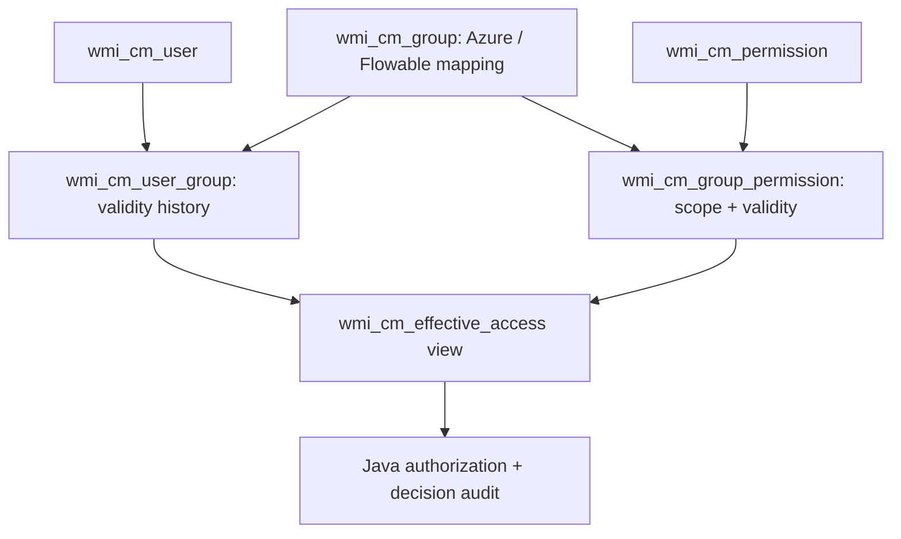
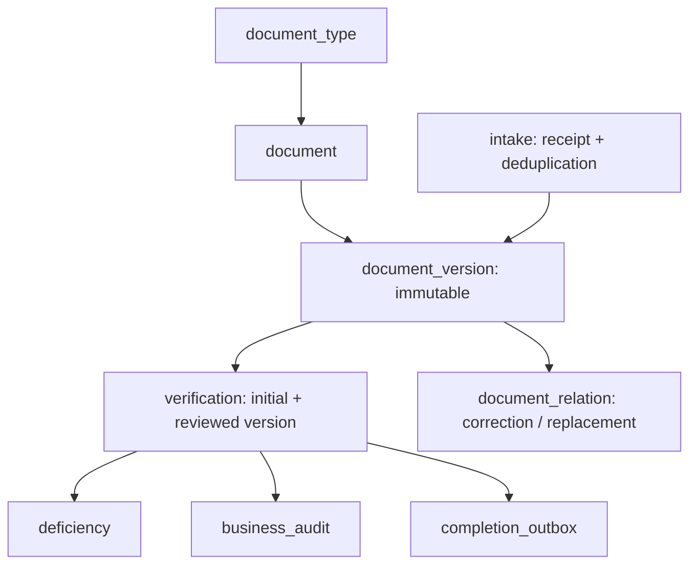

# DocuFlow — Project Understanding and Copilot Engineering Handoff

**Purpose:** Give the IntelliJ Copilot assistant and the development team a durable, detailed understanding of the in-house DocuWare replacement, its business workflows, architecture, implementation boundaries, prior artifacts, and unresolved decisions.

**Prepared:** November 21, 2026  
**Language:** English (US)  
**Document version:** 1.0 — consolidated understanding, for review  
**Status:** Engineering handoff, not an approved business specification or authorization to deploy  
**Suggested repository location:** `docs/copilot/DocuFlow-Project-Understanding.md`

> Read this document before proposing changes. Preserve the distinction between an explicit requirement, a candidate FRD rule, a prototype demonstration, and an architectural recommendation. Missing business rules must remain visible decisions; they must not become silent implementation defaults.

## Contents

1. [How Copilot should use this handoff](#1-how-copilot-should-use-this-handoff)
2. [Evidence, precedence, and limitations](#2-evidence-precedence-and-limitations)
3. [Business vision and scope](#3-business-vision-and-scope)
4. [Technology baseline and conflicts](#4-technology-baseline-and-conflicts)
5. [Target architecture and ownership](#5-target-architecture-and-ownership)
6. [Shared document and workflow rules](#6-shared-document-and-workflow-rules)
7. [Tax workflows](#7-tax-workflows)
8. [Client Verification Partner workflow](#8-client-verification-partner-workflow)
9. [BNMS workflow](#9-bnms-workflow)
10. [Payment workflow](#10-payment-workflow)
11. [Personas, navigation, and UI/UX](#11-personas-navigation-and-uiux)
12. [PDF viewer, checklist, and editing](#12-pdf-viewer-checklist-and-editing)
13. [Java APIs and Flowable orchestration](#13-java-apis-and-flowable-orchestration)
14. [Database and Liquibase](#14-database-and-liquibase)
15. [Identity, SSO, groups, and authorization](#15-identity-sso-groups-and-authorization)
16. [External integration discovery](#16-external-integration-discovery)
17. [Repository, shared platform, and local setup](#17-repository-shared-platform-and-local-setup)
18. [Delivery plan and testing](#18-delivery-plan-and-testing)
19. [Open decisions and implementation gates](#19-open-decisions-and-implementation-gates)
20. [Copilot task prompts and definition of done](#20-copilot-task-prompts-and-definition-of-done)
21. [Source and artifact register](#21-source-and-artifact-register)
22. [Appendix A — Tax FRD v1.2 reference snapshot](#appendix-a-tax-frd-v12-reference-snapshot)
23. [Appendix B — Two-sprint plan reference snapshot](#appendix-b-two-sprint-plan-reference-snapshot)
24. [Appendix C — Preserved D-01 through D-40 decision register](#appendix-c-preserved-d-01-through-d-40-decision-register)
25. [Appendix D — Identity and access persistence contract](#appendix-d-identity-and-access-persistence-contract)
26. [Appendix E — Database schema contract](#appendix-e-database-schema-contract)
27. [Appendix F — Client Verification Partner understanding reference](#appendix-f-client-verification-partner-understanding-reference)

<a id="1-how-copilot-should-use-this-handoff"></a>

## 1. How Copilot should use this handoff

### 1.1 Read order

Read Sections 1–6, then the workflow section relevant to the assigned story, then Sections 12–19 as needed. Use the appendices for exact inventories, requirement IDs, decision IDs, schema contracts, and sprint stories. Do not attempt to generate the entire application from this document in one change.

First inspect the actual repository: parent and module POMs, effective dependency versions, security configuration, deployment profiles, migrations, existing model definitions, API contracts, tests, and repository instructions. Record conflicts with this handoff before changing dependent code.

The user wants business behavior understood before implementation. Ask focused questions where the answer changes routing, access, evidence acceptance, status transitions, or irreversible effects. Continue independent work that does not require the missing answer. Do not present a draft rule as approved merely because it appears in a prototype or generated artifact.

### 1.2 Labels used here

| Label | Meaning |
|---|---|
| Explicit requirement | Direct instruction from the user or clear behavior in readable supplied screenshots. |
| Candidate specification | Detailed rule in a retrieved FRD or engineering document that has no supplied approval record. |
| Prototype behavior | Behavior implemented or described in a demonstration; not automatically a production rule. |
| Recommendation | Proposed engineering approach for review. |
| Open decision | Missing, conflicting, or unapproved policy/contract that needs an accountable owner. |

### 1.3 Working instructions

- Implement only the requested scope and preserve already approved behavior.
- Use the exact target file/repository. `DocuFlow-Prototype.html`, `DocuFlow_Tax_Prototype.html`, `docuflow-tax-assessment.html`, and the standalone PDF viewer are different artifacts.
- Keep HTML prototypes in HTML, CSS, and JavaScript. The user explicitly excluded React code from those prototype deliverables. Production UI is React 19.
- Do not convert invented demo identities, amounts, IDs, document categories, SLA numbers, or endpoint names into production constants.
- Use supported, licensed Flowable APIs and the installed release's actual contracts. Do not invent an Enterprise Java class, REST endpoint, starter, property, or feature entitlement.
- Do not write directly to Flowable engine or IDM tables. Do not expose every native engine endpoint to the browser by default.
- Keep secrets, tokens, real bank documents, internal credentials, and production data out of samples and generated files.
- Treat demo persona switching as a test feature. Production authorization always comes from the authenticated server-side identity and approved entitlements.
- Preserve audit evidence, old document bytes, assessment history, and exact evidence/version references.
- Proposed policies may be demonstrated in isolated fixtures. Missing production policy must block the dependent decision or leave the feature disabled, with an understandable explanation.
- Do not change Java, Spring Boot, Flowable, security, or database baselines to make a sample compile without first resolving compatibility with the actual project.
- No implementation or deployment is authorized merely by this understanding document. Work on the next specifically assigned story.

<a id="2-evidence-precedence-and-limitations"></a>

## 2. Evidence, precedence, and limitations

### 2.1 Evidence used

This consolidation uses the conversation available in this session, readable inline requirement images, and retrieved project artifacts listed in Section 21. The exact current tax FRD, development plan, decision register, and persistence contracts are preserved in appendices to avoid losing detailed tables and identifiers.

Many historical image attachments in the conversation report missing local files. Their contents cannot be reconstructed from their filenames. The readable screenshots cover the core tax design principles, Client Verification Partner, and BNMS in substantial detail. Payment details were recovered from the Payment persona/navigation guide and related prototype materials. Missing screenshots and unavailable versions are not claimed as reviewed.

The actual corporate Java repository, approved enterprise integration contracts, license entitlements, and business sign-off records were not supplied as a complete authoritative implementation baseline. Generated ZIPs and prototypes are reference artifacts, not evidence of production deployment or compliance approval.

### 2.2 Precedence

Use explicit current user decisions and approved requirements for the applicable scope. Use the actual repository and approved platform compatibility matrix for technical compatibility. Use this consolidation to explain intent and trace conflicts. Candidate FRDs, engineering kits, and prototypes supply detail only within their stated approval status.

When two sources disagree, retain both references and request a decision; do not resolve business policy by picking the newest filename. A newer mockup does not by itself supersede an approved workflow. Preserve any actual approved behavior until the owner authorizes its replacement.

### 2.3 Important historical corrections

- The original Account Opening prototype was assumption-driven. It is not the authoritative specification for tax assessment or account opening.
- Account Tax Assessment/BCTS was separated into `docuflow-tax-assessment.html` based on supplied requirements.
- Subsequent requests added a scalable landing workspace, Payment, Client Verification Partner, and BNMS. These additions must share the platform without blending their distinct rules.
- Previous updates targeted the wrong HTML file. Confirm file identity and make a recoverable version before edits.
- Presenter and navigation guides previously referenced nonexistent or mismatched examples such as an Elena Moreau/BCTS navigation path. Regenerate instructions from the exact delivered prototype dataset and labels.
- The user first restricted colors to red, black, and gray, then expressly allowed professional semantic colors, including green completion ticks.
- The user asked to ignore anonymization additions. Keep original supplied document/system codes for internal traceability. Neutral labels may be a presentation option, not a destructive replacement of mappings. Do not decide that a taxonomy is or is not sensitive without the bank's classification policy.

<a id="3-business-vision-and-scope"></a>

## 3. Business vision and scope

Build the bank's own configurable, reusable, auditable document and workflow application to replace its fragmented DocuWare enterprise environment. Familiar terms and journeys should help existing users adopt it, while the UI should be original, clearer, and more useful rather than a copy of DocuWare or UBS public pages.

Core principle: **Store once, validate according to governed rules, reuse eligible evidence safely, orchestrate business assessments separately, and audit the entire history.** Reuse must consider context, validity, version, permissions, and the target process's rules; it does not mean every historical validation is valid forever.

Hive is described by the user as the bank's golden source where different business applications ultimately store data. The application must integrate with multiple departments and preserve field/document ownership. This does not establish that Apache Hive supplies a DocuWare-style UI or a low-latency transactional document API.

### 3.1 Capability ambitions

The original mapping is a target capability list, not a verified assertion that each item is included in the purchased Flowable edition.

| Familiar capability | Target behavior | Proposed ownership / caveat |
|---|---|---|
| File Cabinets | Logical libraries, indexed documents, hierarchy and saved views | Application content model plus approved repository/Flowable content services. |
| Index Fields | Governed metadata and data dictionary | Java validation, PostgreSQL, versioned configuration. |
| Folder Structures | Hierarchical browsing and virtual folders | React and metadata queries; avoid equating a UI folder with physical Blob layout. |
| Full-Text Search | Authorized metadata and content search | Search integration to be selected; Elasticsearch was proposed, not a verified mandatory deployment. |
| Versioning | Immutable content versions and explicit replacement lineage | Document service and repository capabilities; reconcile identity semantics first. |
| OCR / extraction | Future classification, extraction, and assisted validation | Day 2/future integration; not an approved Day 1 automatic authoritative update. |
| Automation | Embedded document workflows and intentional business processes | Flowable BPMN/CMMN; governed decisions where appropriate. |
| Digital forms | Structured dynamic forms and checklists | React/Flowable form strategy requires a deliberate ownership decision. |
| Access | Role/group, context, document, task, and field authorization | Company SSO, Java security, Flowable task eligibility. |
| Audit | Decisions, metadata, access, versions, routing, and integration history | Combined application audit and engine history; not engine history alone. |
| Mobile | Responsive web first | Native mobile capability is a future option, not a demonstrated entitlement. |
| Email intake | Capture permitted messages/attachments | Future/custom intake adapter with approved controls. |
| Office editing | DOCX/XLSX in original format | Day 2 consideration; WOPI/Office integration requires separate product and licensing validation. |
| E-signatures | Controlled signature workflow where required | Provider integration and evidence policy needed; a drawn mark is not a verified digital signature. |
| Templates | PDF/Word renditions from structured data | Versioned generation service/template strategy. |
| Archival | Completed and archived cases with retained evidence/history | Separate completion, archival, retention, legal hold, and disposition rules. |

### 3.2 Workflow inventory

There are **seven named workflow families** in the accumulated business scope. This count is a planning taxonomy, not a count of BPMN deployments, subprocesses, or every scenario.

1. Single Tax Document Verification (embedded; 20 candidate context/subtype combinations).
2. Country-Specific Tax Documents (embedded; 25 candidate Account/Partner combinations).
3. Tax Relief at Source (intentional business process; New Business and Termination branches).
4. Account Tax Assessment / BCTS (intentional business process).
5. Payment (PPSP single-payment and PPMP multi-payment variants).
6. Client Verification Partner (six named document/context combinations; wider signature scope unresolved).
7. BNMS (intake, HIT assessment, Compliance/Business Acceptance and operational control branches).

Shared signature checks, quality control, account availability waits, replacement, and archiving may be reusable subprocesses/capabilities. Do not count the initial assumed Account Opening journey as an eighth approved family. It remains a possible future module once actual requirements arrive.

The initial two-sprint engineering increment is narrower: **Single Tax Document Verification and Country-Specific Tax Documents only**. Payment, BNMS, BCTS, and the other families are not implicitly included in that delivery commitment.

<a id="4-technology-baseline-and-conflicts"></a>

## 4. Technology baseline and conflicts

| Area | Requested direction | Implementation handling |
|---|---|---|
| Java | JDK 17 | Preserve this requested baseline until actual Flowable/BOM compatibility is confirmed. |
| Frontend | React 19; initial conversation also mentioned 18/19 | Production React 19; prototypes remain plain HTML/CSS/JS. |
| Workflow | Flowable Enterprise, written as “17/2025.2” and later 3.17.x examples | Resolve marketing release, exact artifact versions, supported JDK/Spring versions, and purchased products. |
| Cloud | Azure | Use approved bank landing zone, identity, network, and deployment practices. |
| Binary storage | Azure Blob Storage mentioned | Confirm whether it is underlying Hive storage, a rendition store, staging, or authoritative binary storage. |
| Golden source | Hive | Establish the actual service and data ownership contract. |
| Relational database | PostgreSQL | Target version and Azure service configuration still need confirmation. |
| Migrations | Liquibase | Application schema `workflow_wmi`; table prefix `wmi_cm_`. |
| Grid | Licensed AG Grid Enterprise | React integration and features must fit the purchased version; do not embed a license key in a shared artifact. |
| IDE | IntelliJ with Copilot | Use this file as explicitly supplied context; verify the repository before scaffolding. |
| PDF | Open source preferred | Viewing, form filling, and PDF generation/editing are separate capabilities. |

Retrieved samples are inconsistent. A shared framework reference used Java 17, Spring Boot 3.5.12 and Flowable 3.17.15; a Copilot kit referenced 3.17.16 / Boot 3.5.14 / springdoc 2.8.15; a corrected local scaffold used Java 21 / Boot 3.5.14 / springdoc 2.8.16. These are **artifact baselines, not an approved version recommendation**. The Java 21 sample conflicts with the user's JDK 17 request. Resolve this before dependency or starter changes. Do not infer that Flowable “2025.2” equals a specific 3.17.x artifact.

The PDF module's Node/React/PDF library requirements also belong to its own sample version; they do not independently mandate a bank-wide frontend upgrade. No current vendor compatibility claim is made by this handoff.

<a id="5-target-architecture-and-ownership"></a>

## 5. Target architecture and ownership

### 5.1 Three-layer operating model

| Layer | Responsibility | Examples |
|---|---|---|
| Core document and task platform | Common metadata, storage references, validation, identity, permissions, deficiency/replacement history, audit, integrations | Document ID, upload controls, immutable version reference, access decision, external event correlation. |
| Business Process Library and role workspaces | Process discovery, authorized initiation, drafts, queues, task execution, completion history, blockers and notifications | My Tasks, Team Queue, Returned Work, Completion Library. |
| Domain modules | Workflow-specific forms, rules, decisions and routing | Tax, Payment, Client Verification Partner, BNMS. |

Recommended technical boundaries:

- **React:** Render authorized tasks and forms; support document viewing, accessible navigation, conditional UI, draft capture, and understandable status. Browser checks improve usability but cannot authorize or finalize business decisions.
- **Java application APIs:** Establish authenticated identity, enforce permissions/validation/segregation, execute business commands, handle concurrency and idempotency, access repositories, persist business facts, orchestrate integrations, and record audit.
- **Flowable:** Own active process/case/task execution, assignments, human decision sequencing, timers, and appropriate process history. Models should express approved routing, not duplicate a separate Java state machine with different semantics.
- **PostgreSQL application tables:** Own application projections, governed metadata/references, deficiencies, decision/evidence records where needed, identity mapping, application audit, and reliable event delivery. Do not duplicate every engine table or put documents in JSON columns.
- **Hive / content repository / Blob:** Own bytes and authoritative records according to an agreed contract. Keep source IDs, version IDs, hashes and provenance so the relationship is explicit.
- **Integration adapters:** Isolate Hive, iCRM, OBS, BECOM/account events, archival and identity contracts. Demo adapters remain distinguishable from live integrations.

### 5.2 Consistency recommendations

Use a stable application business key to correlate a workflow instance, task commands, repository objects, and audit events. Specify transaction boundaries; do not assume an HTTP call to a remote engine and a database update are one atomic transaction. Use an outbox/inbox or an equally explicit reliability pattern for external effects. Reconcile uncertain outcomes before retrying a process start, payment release, or authoritative write.

Record the model version, form schema version, rule version and relevant evidence snapshot at the decision. Define what a new model/rule deployment means for existing instances. Stable workflow keys do not authorize automatic instance migration.

Keep policies configurable under governance. Configuration changes need validation, approval, effective dates, audit, and tests just as code changes do. “Configuration first” is not permission for an administrator to bypass controls.

<a id="6-shared-document-and-workflow-rules"></a>

## 6. Shared document and workflow rules

### 6.1 Identity, ownership, and indexing

- A submitted document receives a persistent, machine-generated identity.
- Four-character document codes alone are insufficient routing keys. Include Account/Partner ownership and, where necessary, natural person/entity/controlling-person subtype, country, document format, and the applicable policy version.
- Keep Account and Partner variants distinct, including where the document code is identical.
- Candidate account hierarchy identifiers are umbrella (7 digits), mandate (6 digits), and portfolio (7 digits). Treat them as strings and preserve leading zeros. Confirm validation and default ownership rather than inferring it from a client name.
- Support approved provisional account context where the account does not yet exist. Do not invent an account identifier to bypass a wait.
- Capture original filename, display name, MIME type, content hash, byte size, page count when available, source, ownership links, documentary format, received/uploaded times, actor, and relevant business metadata.
- Changing a display name is not replacing the content. Editing a submitted document must preserve the prior evidence and follow the approved correction/version process.

### 6.2 Controlled upload

The candidate matrix differentiates **documentary format** from technical file format:

| Documentary format | Candidate uploader/channel | Decision still needed |
|---|---|---|
| Paper Original | CDDM Luxembourg/designated scanning team; physical receipt and internal scanning | Custody, scanning evidence, retention, exceptions. |
| Digital Original | CRM, CSM, Desk Head, Intern; approved digital source/channel | Intern authority and proof of original electronic source. |
| Copy Valid as Original | Same candidate Front Office roles where type rule permits | Exact eligible types and certification evidence. |
| Simple Copy | Original slide said all teams/permitted intake | D-13 requires approved role/channel scope; do not grant all teams by default. |

Validate before starting workflow: document/context eligibility; ownership and account state; permitted documentary format; uploader and channel; mandatory metadata; resolved routing/form configuration; external lookup status; duplicate/correction/replacement intent. Invalid combinations must be explained to the user and blocked at the authoritative backend boundary.

Retain original bytes. Any preview, OCR output, PDF/A rendition or conversion must be linked to its original and must not silently destroy digital signatures, seals, layout, or evidence meaning. Signature validity after conversion is an explicit decision.

### 6.3 Automatic vs intentional initiation

Eligible document upload automatically triggers the configured embedded workflow. Users do not select a competing verification process manually. The Business Process Library intentionally starts Tax Relief and BCTS with structured forms and checklists. The architecture should support both patterns without double-starting work on retries.

### 6.4 Keep state dimensions separate

| Dimension | Examples | Key distinction |
|---|---|---|
| Intake | Received, validation failed, registered | Receipt is not documentary acceptance. |
| Documentary result | Tax: Processing/Complete/Incomplete/Rejected/Replaced; CVP/BNMS: Processing/Valid/Invalid with intermediate review states | Each vocabulary needs an explicit family mapping, not a universal overloaded enum. |
| Task execution | Draft, active, returned, blocked, completed | Task completion may lead to another control. |
| Business decision | Tax approved, client kept, Partner refused, pending | A Valid document does not imply a positive business decision. |
| Account readiness | Found, pending/not yet created, unknown, mismatch | Unavailable is not not-found or approved. |
| Operational implementation | OBS capture pending/confirmed; iCRM capture pending/confirmed; payment release state | A form checkbox does not prove a remote operation occurred. |
| Retention | Active, completed, archived, legal hold, disposal eligibility | Completion is not archival or deletion permission. |

Tax documentary completion, Tax approval, account availability, OBS implementation, and any input/check control are independent milestones. Their UI indicators must reflect actual recorded outcomes. Use green ticks for positive completed milestones; show negative or reversed outcomes explicitly.

### 6.5 Deficiencies, returns, and replacements

Deficiencies need reason, comment, target document/version/context, owner, severity, blocking effect, timestamps, due date if governed, remediation evidence, and authorized acceptance. Candidate lifecycle: Open → In Remediation → Resolved → Accepted → Closed; Waived is separate and requires authority. A maker reporting “resolved” must not silently accept their own correction.

A return or rejection records actor, reason/comment and audit. The early core requirement makes these mandatory; the CVP signature slide calls a rejection comment “recommended.” Keep this conflict open rather than weakening the shared requirement silently.

**Identity conflict to resolve:** The candidate tax FRD describes a replacement as a new Document ID, retaining the predecessor until the replacement is accepted. The later schema supports immutable versions under a logical document and correction/replacement relations. Decide the distinction between a technical version, a correction in the same workflow, and a genuinely replacing document. Do not collapse these concepts.

Preserve predecessor bytes and decisions; prevent cycles and conflicting accepted successors; link exact evidence used by assessments. Pending replacement must not automatically invalidate the old accepted record. Accepted replacement, expiry, or changed metadata may affect linked assessments according to an approved impact/revalidation policy.

### 6.6 Completion and archival

Provide a completion history and a separate Archived section for completed/archived cases and workflows. Show negative outcomes distinctly. Archived views are normally read-only; approved correction/reopen/restore behavior needs explicit authorization and history. Retention periods, legal holds, storage tiering, access after archival, and disposal are unresolved policies, not demo defaults.

<a id="7-tax-workflows"></a>

## 7. Tax workflows

Appendix A preserves the complete candidate FRD, including the 20/25 inventories and requirement IDs. The following is the engineering interpretation.

### 7.1 Embedded Workflow 1 — Single Tax Document Verification

Candidate inventory: 20 Account/Partner/subtype combinations across B832, BAEI, BAIE, BCLN, BEUP, BFAT, BUAC, BUPC, BW8B, BW8E, BW8I, BW9B and BWUI. Repeated codes represent real context/subtype variants and must not be deduplicated away.

Flow: authorized intake → configured metadata/context validation → signature review where applicable → CDDM Poland documentary verification → Tax documentary review where required → documentary outcome and completion history. An independently linked tax/business assessment may reuse eligible evidence afterwards.

The signature performer, exact Tax review matrix, Intern authority, qualifying-document values, and incomplete-evidence reuse require decisions. Do not default an unresolved review requirement to false. Rejection/deficiency correction must preserve reasons and prior evidence.

### 7.2 Embedded Workflow 2 — Country-Specific Tax Documents

Candidate inventory: 25 Account/Partner combinations across BCRD, BCRG, BCRN, BCRR, BCRS, BFCR, BICR, BITD, BNDS, BNOL, BPCR, BRPM, BTAG, BTAI, BTAS, BTAY, BTEI and BUAN.

Typical candidate route: physical receipt → CDDM Luxembourg scanning/classification → configured format/context checks → CDDM Poland verification → documentary outcome → eligible reuse in Tax Relief or another authorized assessment.

Paper Original appears as a baseline in the draft; it is not a blanket approved format for all 25 combinations. Resolve D-06 per type/context. Country-specific labels are public jurisdictions but the actual applicability rules require business approval; do not invent tax-law requirements from a document name.

### 7.3 Business Process — Tax Relief at Source

Initiate from the Business Process Library. Distinguish New Business and Termination.

New Business candidate steps: Front Office structured BTAX request → governed BTA1–BTA9 allocation → country/service-specific evidence selection → applicable authorization/signature evidence → Luxembourg Tax assessment → account readiness → CDDM Poland implementation → final confirmation.

Capture client/account/service context, tax profile, legal structure, effective dates, rates/conditions where applicable, request declarations, and the exact evidence references. BTA allocation must use a versioned decision matrix. Do not default to BTA1. Override authority remains to be agreed.

Termination: BTER treatment remains open. Identify the specific service/country being terminated rather than terminating everything for a client. Keep requested, intended effective, confirmed and actual implementation dates separate. Clarify external authority communications and signed evidence. Creating a request for another country should revalidate evidence and rules, not blindly clone approval.

### 7.4 Business Process — Account Tax Assessment / BCTS

BCTS may be linked to onboarding or run independently. It must not depend on assumptions from the old Account Opening demo.

Candidate stages: structured request/checklist → qualified evidence selection → Luxembourg Tax assessment → OTL sign-off where required → account availability gate → CDDM Poland input → independent check → completion. Preserve Tax approval when account creation or implementation is pending; show each milestone separately.

The checklist captures relevant identity and US citizenship/residency/indicia/visa information and conditionally applicable evidence. The candidate “at least five categories” means approved evidence categories, not five arbitrary files or five screens. The exact category/conditional matrix is open. Illustrative IDEN/BAEI/ADDR/NATL/DECL categories and W-8/W-9/BCLN conditions must not be treated as a final tax classification policy.

Retain mappings to the supplied OBS field groups/codes such as KS001, KS013, WT002, KT009U, KS010, KT075/KS039J and controlling-person comparison where specified. A neutral presentation label must retain the original mapping behind it. Exact form-to-system field mappings and approved allowed values still need confirmation.

### 7.5 Account wait and resumption

An approved assessment may wait for account creation using approved client/Partner/provisional references. The candidate BECOM event or authoritative lookup must correlate the right account, tolerate duplicates/out-of-order events, and expose mismatches for resolution. Account existence does not imply the earlier evidence is still fresh. Resume only under an approved freshness and revalidation policy; do not erase the earlier assessment.

<a id="8-client-verification-partner-workflow"></a>

## 8. Client Verification Partner workflow

### 8.1 Confirmed scope from readable screenshots

| Code | Document | Ownership |
|---|---|---|
| BPAC | Passport / ID Certified | Partner |
| BPAN | Passport / ID Non Certified | Partner |
| BREG | Commercial Register | Partner |
| BREG | Commercial Register | Account |
| BSTT | Statutes / Memorandum / Articles of Association | Partner |
| BSTT | Statutes / Memorandum / Articles of Association | Account |

The objective is to confirm the expected signature, validate the client/legal name against OBS and iCRM, and apply an independent check when a deficiency is corrected. Account and Partner variants remain separate.

### 8.2 Execution

1. Upload an eligible document/context and create the verification work.
2. **Client Advisor signature check:** Review the document and decide whether the expected signature is acceptable. Record result, checker and timestamp, with rejection evidence/comment according to the resolved rule.
3. If signature is **not OK**, set document Invalid and end this process. The slide explicitly says no parking status.
4. If signature is **OK**, set document Valid and route to CDDM Poland for name checking. This Valid status does not mean the name-check workflow has finished.
5. **CDDM Poland name check:** Compare the relevant client/legal name with both OBS and iCRM. Capture source values and the comparison decision. Detailed matching and unavailable-system rules are not supplied.
6. If there is **no deficiency**, complete directly, retaining full history.
7. If correction is needed, record deficiency, correction and evidence; create an independent four-eyes check.
8. If four-eyes is OK, complete with maker/checker identities, decision, comment and timestamps.
9. If four-eyes is not OK, the supplied proposal returns to the CDDM maker for correction/recheck. Final failed-control treatment, limits and escalation remain unconfirmed.

The screenshot notes 435 additional document types in column I (“Signature check Workflow”) of `Final doc type list and upload fields v1.xlsx`. That spreadsheet was not supplied as an authoritative complete inventory here. Confirm whether the 435 receive only the signature gate or the entire name-check/control process. Do not expand all six-family rules to 435 documents automatically.

### 8.3 Required screens and demo roles

A proposed task view includes document/context summary, multi-page viewer, signature decision, OBS/iCRM comparison, deficiency/correction form, independent-check decision and chronological audit. Separate documentary status from workflow stage.

Reference demo identities: Alex Morgan (Client Advisor), Marta Kowalska (CDDM Poland maker), Piotr Nowak (CDDM Poland checker). Illustrative cases include Elena Moreau/BPAC Partner, Northbridge/BREG Account, and Meridian/BSTT Partner. These are demo data, not production identities. A prior demo's PDF size limit and static external names are not business requirements.

### 8.4 Open questions to settle

- CVP-01: Are the six combinations the full Day 1 scope? What exactly applies to the 435-type list?
- CVP-02: Who is eligible to perform signature review, and what constitutes an acceptable signature for each type, including register extracts or unsigned evidence?
- CVP-03: Is a rejection reason/comment mandatory? Resolve the conflict between the common mandatory rule and the slide's “recommended” wording.
- CVP-04: What name comparison rules apply to punctuation, accents, transliteration, legal suffixes, aliases, multiple holders and natural/legal persons? Which source wins on disagreement?
- CVP-05: Who corrects OBS/iCRM, through what authority, and what proves the correction? Is write-back in scope or only confirmed external work?
- CVP-06: Must the checker differ only from the correction maker or also from uploader/signature reviewer? How are delegates and multiple logins mapped to the same human?
- CVP-07: What happens after failed four-eyes: return, reject, escalation, retry limit, and eventual terminal status?
- CVP-08: How are missing, stale, conflicting, or unavailable OBS/iCRM records handled?
- CVP-09: Does replacement restart signature and name checks? What duplicate/resubmission behavior is required?
- CVP-10: Which upload roles, queues, SLAs, notification rules, retention and access restrictions apply?

Appendix F retains the prior workflow understanding and additional review context. BNMS controls must not silently overwrite CVP failure rules; their supplied routes differ.

<a id="9-bnms-workflow"></a>

## 9. BNMS workflow

### 9.1 Responsibilities

| Team | Responsibilities |
|---|---|
| CRM | Index metadata, verify document nature/usability, reject invalid evidence with comment, assess No HIT/False HIT/True HIT, respond to Compliance questions, confirm iCRM capture. |
| Compliance | Review True HIT, request information, conclude not relevant, accept with conditions, record indicators/conditions, or mark Partner not supported. |
| Business Acceptance (BA) | Decide keep client/refuse Partner, record mandatory decision comment and evidence, retain visible business outcome. |
| CDDM Poland | OBS code capture, four-eyes control, correction after failed control, final documentary quality control. |

**Central rule:** The BNMS document may be Valid even when BA refuses the Partner. Preserve the negative business outcome, comments and evidence separately from document status.

### 9.2 Scenarios and routing

| Scenario | Required action/evidence | Next stage |
|---|---|---|
| S0 — Intake | Upload under BNMS, create Processing document, CRM indexes and checks nature/usability. Exact metadata catalog remains open. | CRM assessment. |
| S1 — Reject document | Mandatory rejection comment; document Invalid. | Stop this document's workflow. |
| S2.1 — No HIT | Green stamp and “No negative news found”; assessor/time and No HIT flag. | Document Valid → final CDDM QC. |
| S2.2 — False HIT | Negative information found but not relevant; mandatory relevance comment. | Document Valid → final CDDM QC. |
| S2.3 — True HIT | Red stamp “Negative information found – Compliance informed”; mandatory indicators and hit evidence. | To be validated by Compliance. |
| A — Additional information | Compliance mandatory question; CRM mandatory reply; preserve author/time and repeated exchanges. | Return to Compliance; repeat A or choose B/C/D. |
| B — Reviewed, not relevant | Compliance mandatory comment and decision, retain previous hit evidence/conversation. | Document Valid → final CDDM QC. |
| C1 — Accepted with conditions, all indicators No | Conditions and all five indicators explicitly completed. | BA review, then Valid → QC for keep or refuse, with business outcome separate. |
| C2 — Accepted with conditions, any indicator Yes | Conditions and indicators retained. | CDDM OBS capture → four-eyes → CRM iCRM capture → Valid → QC. |
| D — Partner not supported | Compliance mandatory rationale/comment. | BA keep/refuse → document Valid → QC, refusal separately visible. |
| QC — Final control | Verify document, index, stamps, comments, decisions, capture confirmations and history. | Complete, or configured return/rejection with recorded reason. |

Mandatory True HIT indicator fields: **PEP, SCAP, SIAP, 50Mio+, NTPB**, each Yes/No. Do not invent their business definitions or default unanswered to No. Hit evidence includes a four-line comment area describing hits, checkbox “All negative news identified,” “HITs written on the NMS” Yes/No, red stamp and assessment history. A four-line UI field does not establish a requirement for exactly four nonempty lines of text; confirm validation semantics.

For accepted-with-conditions decisions, capture the acceptance requirements in the specified four-line area and evaluate the five explicit indicators. All No routes to BA; any Yes routes to operational capture.

### 9.3 CDDM capture and four-eyes

For C2, CDDM Poland captures the code in OBS; an independent checker reviews it. Failed control stays with CDDM for correction and repeated four-eyes review. It must not route to CRM until the control passes. CRM then captures the code in iCRM and answers mandatory “Captured in iCRM” Yes/No. The exact behavior for No needs approval; a prototype may hold the task, but must label that as provisional.

Record OBS capture evidence, canonical maker/checker identities, control outcome, iCRM confirmation and status transition. Manual confirmation and actual remote success must be distinguishable.

### 9.4 BA and final QC

For C1, keep requires mandatory comment and evidence reference, with attachment possible; refusal requires mandatory comment and reference plus attachment as depicted. Scenario D also requires decision evidence; resolve exact attachment requirement in the final matrix. Both decisions produce a Valid document and go to CDDM QC. Refusal remains visible as Partner refused in the workflow and completion views.

All successful documentary routes converge on final QC. A failed QC requires a recorded reason and configured target/routing. The screenshots do not fully determine every return/reject state transition. Do not convert a prototype's QC fallback into business policy.

### 9.5 Persona and evidence examples

Reference demo roles: Alex Morgan (CRM), Lea Bernard (Compliance), Daniel Weber (BA), Marta Kowalska (CDDM maker), Piotr Nowak (CDDM checker). Demo cases span intake, Compliance review, four-eyes, and a refused-Partner QC case. Stamps in a prototype may be side records/visual overlays; they are not automatically cryptographic PDF signatures.

Open BNMS decisions: metadata catalog; indicator definitions and ownership; stage-specific mandatory fields; applicability to Account/Partner; external write/confirmation evidence; “Captured in iCRM = No”; QC failure target and documentary status; independence scope; attachments; SLAs and escalation; replacement and reassessment impact.

<a id="10-payment-workflow"></a>

## 10. Payment workflow

The original Payment screenshot files were not readable in this conversation. This section is grounded in the retrieved Payment persona guide, workflow materials and prototype behavior. Its thresholds, role assignments and boundary decisions require business confirmation.

### 10.1 Scope and flow

PPSP represents a single-payment request with exactly one transaction. PPMP represents a multi-payment request with at least two transactions in the demo. Keep case, transaction, beneficiary, evidence and control identities separate.

Proposed demo sequence:

1. CSM creates/indexes the request, identifies umbrella/subfund context and supplies evidence.
2. CSM checks signature and authority.
3. Applicable callbacks run per transaction; PERE controls run in parallel under the approved case/line scope.
4. Unknown or incomplete mandatory controls block operational capture/release.
5. CDDM/Poland Cash maker records OBS execution/capture with a distinct transaction reference per line.
6. A different eligible checker or supervisor performs the appropriate release control.
7. Completion and archival retain decisions, evidence, transaction outcomes and full history.

**Capture is not release; release is not settlement.** An OBS reference alone is not authoritative evidence of release. Define reconciliation and uncertain-result handling before live money movement.

### 10.2 Callback and PERE rules are not approved defaults

The demo illustrates a proposed USD 25,000 callback policy, including a hold at the exact boundary and non-USD handling requiring approved FX source/time/rounding. Changed or unknown bank details require attention; reuse of a previous callback needs explicit qualifying conditions. Do not ship any numerical threshold, comparison operator, bank-match rule or reuse rule without approval.

PERE scope and first-capital-call indicators must distinguish Yes/No/Unknown. An unknown feed must not skip controls. The demo sends first-capital-call cases through Depositary legitimacy and Ops investment/callback controls, with additional recovery handling for a red Depositary outcome. Red outcomes and unsuccessful callbacks have specific demo return/stop behavior; confirm whether they are recoverable, who acknowledges them, and whether restart creates a linked case.

For PPMP, clarify whether PERE controls cover each transaction or the entire case, whether partial release is allowed, how aggregate/supervisor thresholds work, and how one failed line affects others. Resubmission or beneficiary/amount/evidence changes must invalidate stale controls according to an approved impact matrix.

### 10.3 Demo personas

| Persona key | Demo name | Demo responsibility |
|---|---|---|
| pcsm | Emma Laurent | Payments CSM; intake and customer-side controls. |
| pops | Thomas Becker | PERE Operations. |
| pdep | Isabelle Meyer | Depositary PERE. |
| pmaker | Anna Zielinska | Poland Cash maker / OBS capture. |
| pchecker | Jakub Wisniewski | Poland Cash checker. |
| psuper | Ewa Lewandowska | Poland Cash supervisor. |

These are demonstration identities and keys, not corporate group IDs. A user may see a case without being able to claim or execute its current task. Define production visibility separately from task execution rights.

### 10.4 Demo navigation and fixtures

The Payment guide describes Overview, My Tasks, Team Queue, Waiting/Parallel Controls, Returned to CSM, Release Queue, Completed/Archived, Scope/Decisions and a Tax Workspace link. Case tabs include Overview, Transactions, Controls, Execution, Documents and Audit. Queue counts in that guide count cases rather than tasks; preserve the distinction in labels and metrics.

Demo fixture references include 2001 Northbridge Infrastructure (first capital call), 2002 Alderstone (multiple transactions), 2003 Meridian Fund (capture), 2004 Westhaven (checker release), 2005 Redwood (supervisor release), 2006 Linden (EUR/FX hold), 2007 Harborview (stopped), and 2008 Oakfield (draft/changed bank). Verify exact current IDs, values and labels from the delivered prototype before writing a presentation script.

D-30 through D-40 in Appendix C preserve Payment decisions on priority, thresholds/FX, callback ownership, beneficiary matching, PERE scope, first call, PPMP scope, stopped cases, release evidence and BUNT/BUPM/BASI evidence. These are not closed decisions.

<a id="11-personas-navigation-and-uiux"></a>

## 11. Personas, navigation, and UI/UX

### 11.1 Landing workspace

Provide a reusable shell and personalized landing page that scales as workflow families are added. The user should immediately see their work, team responsibilities, blockers, returned items, aging and next action. The landing screen must not be hard-wired to BCTS or one assumed Account Opening case.

Recommended navigation: Dashboard/Home; My Tasks; Team Queues; Workflows & Tasks; Business Process Library; File Cabinets/Documents; Returned/Blocked Work; Completion Library; Archived; Audit/Reports; authorized administration. Final labels should align with the delivered prototype and business terminology. Do not add navigation entries that lead to nonfunctional screens without a clear demo label.

Keep workflow discovery distinct from automatic document verification. A library card for an embedded verification family can explain/upload eligible documents; it should not offer a conflicting manual workflow selector.

### 11.2 Shared case/task experience

Use consistent structures for overview, current task, document evidence, milestones, comments/conversations, and audit. Domain-specific forms and controls plug into this structure. Show current owner, stage, age, reason for blocking, and next action. Do not hide status distinctions in a single green “Completed” badge.

Use AG Grid for substantial queues with search, sort, filters, appropriate pagination/server-side query behavior, accessible row actions, column preferences and exports if authorized. A license is not a reason to make every form a grid. Define export visibility and sensitive-data handling.

### 11.3 Visual and interaction requirements

- Red/black/gray brand foundation inspired by the references, with original layouts.
- Professional semantic colors: green for confirmed success, amber for attention/pending, red for failure/negative decision, blue/purple where useful for informational/team distinctions.
- Pair color with text/icons; do not communicate approval solely through color.
- Increase readability over the early small-font prototype. Proposed base typography is approximately 16px with clear hierarchy, subject to UI review rather than a frozen specification.
- Keyboard navigation, visible focus, labeled fields, understandable errors, responsive layouts, useful empty/loading/error states and sufficient contrast.
- Clear save-draft versus submit/approve actions. Protect unsaved work and prevent duplicate submissions.
- Multi-page and multi-document viewers should not lose the user's task context or checklist changes.
- Display reasons for disabled actions instead of leaving business users to guess.

### 11.4 Demo persona behavior

Tax example personas are Alex Morgan (Front Office), Sophie Laurent (Luxembourg Tax), Claire Muller (CDDM Luxembourg/Scan), Marta Kowalska (CDDM Poland/Data Input), Piotr Nowak (CDDM Poland/Data Check). Other workflows have their own personas listed above.

Changing the demo persona should update visible queues, allowed actions, relevant screen sections, and counts against the same shared underlying case dataset. It should not create a disconnected private copy of every case or lose prior decisions. Demonstrate segregation of duties by changing to an eligible different human. Clearly label the selector as demo-only.

### 11.5 Presentation artifacts

Keep the prototype, `DocuFlow-Demo-Presenter-Guide.html`, `DocuFlow-Workflow-Coverage-and-Navigation.html`, and Payment user-group/persona guide synchronized to one artifact version and dataset. Each demo step should specify persona, actual navigation, actual case ID, action, expected result and business rule. Include assumptions and unresolved decisions. Do not invent a case merely to make the script sound complete.

<a id="12-pdf-viewer-checklist-and-editing"></a>

## 12. PDF viewer, checklist, and editing

### 12.1 Required experience and phased scope

The user prefers open source. Day 1 focuses on PDFs, including editable checklist/form experiences. Editing and saving DOCX/XLSX in their native formats is a Day 2 consideration.

One PDF and two or three PDFs should use the same viewer design: an evidence list or document tabs, active document, page navigation/thumbnails, zoom, fit, search when text is available, and controlled document actions. For a single file, simplify the list without changing basic controls. Preserve active page and edits when switching documents where feasible.

Rename/replace are document-management operations. Annotation, AcroForm filling, checklist-driven rendition and arbitrary PDF text/content editing are different capabilities. Confirm which are required; do not promise all of them under “editable PDF.”

### 12.2 Retrieved viewer artifacts

The standalone HTML viewer source includes PDF viewing/form demonstration assets and PDF manipulation support; it is a prototype, not a production repository or signature service. A later reusable React 19 viewer package provides a viewing-focused module with local-file/URL sources, page search, comparison through two instances, CSS customization and host callbacks for print/download. Its existence does not mean the React package already implements the full BCTS checklist or permanent repository save.

The reference module uses `react-pdf`/PDF.js for viewing; the standalone prototype includes `pdf-lib` for PDF manipulation/form output. Treat these as candidates and existing artifact choices. Validate maintenance, license obligations, browser support, accessibility, workers/CSP, large-file behavior and the approved package versions before adopting them. Search on scanned image-only documents requires OCR upstream; do not imply that viewer search performs OCR.

Serve required worker/font/CMap or other assets from an approved origin, with version alignment. Host applications own authenticated document retrieval and action authorization. Revoke temporary object URLs when appropriate. Do not send confidential PDFs to public conversion/viewing services.

### 12.3 Dynamic checklist recommendation

Use a versioned structured data model for checklist answers and rules. A checkbox/dropdown can change visibility, requiredness, available values and calculated/rendition fields. The backend must validate the same business requirements before task completion. A hidden field must not quietly retain a stale value that changes routing; define retain/clear/read-only behavior explicitly.

Recommended ownership:

1. Business owns an approved field/condition/rule matrix and document template version.
2. React renders the digital checklist and immediate conditional feedback.
3. Java validates data and permissions, persists drafts/submission snapshots, and invokes the workflow command.
4. Flowable routes work using approved decision facts and task/case context.
5. A rendering service generates or fills the PDF from the accepted structured snapshot, preserving template and evidence provenance.

A filled PDF is an evidence/rendition artifact; avoid making arbitrary embedded PDF JavaScript the authoritative business rule engine. If an incoming PDF contains AcroForm fields, map them to explicit approved fields and validate imported values. Do not infer signature authenticity from a filled checkbox or drawn signature.

### 12.4 Flowable forms vs custom React

Both approaches are plausible; the licensed product/version and project conventions determine which is supported.

- **Flowable-owned forms:** Prefer when the installed form renderer/designer supports the required behaviors and governance. Confirm supported embedding/integration, conditional logic, customization, and version binding.
- **React-owned task forms:** Use a versioned application form contract linked to Flowable task/process/case IDs. Java retrieves task context, returns allowed actions and form data, validates commands, then calls supported Flowable services. React need not pretend that its component is a native Flowable form.
- **Hybrid:** Use native forms for simple standardized tasks and React for richer evidence/checklist screens, with one authoritative data and validation ownership model.

Avoid maintaining two independent sets of branching rules in React and a Flowable form without reconciliation. If the same rule executes in multiple layers, generate/share an approved rule contract or test parity explicitly. Only routing-relevant facts should become engine variables; large files and sensitive document payloads stay in their proper store.

### 12.5 Persistence and control

Save drafts separately from submitted decisions. Use concurrency tokens so two editors cannot silently overwrite each other. Saving a new PDF version records parent/version, hash, actor and reason. Existing approvals may need revalidation after changes; the policy is open. Annotations require author/time and a decision on whether they are overlays, separate records, or a flattened rendition.

Digital signature workflows require an approved provider/verification approach, identity, certificate/timestamp evidence and a policy for post-signature modifications. Simple visual signatures or demo stamps must be labeled accurately.

<a id="13-java-apis-and-flowable-orchestration"></a>

## 13. Java APIs and Flowable orchestration

### 13.1 Proposed application contracts

These are application capabilities to design, not claims about built-in Flowable endpoints:

| Capability | Contract considerations |
|---|---|
| Current authenticated user | Resolve verified principal, app identity, effective roles/scopes and permitted workflows; no browser-supplied actor. |
| Workspace/queues | Authorized filters, pagination, counts, owner/stage/age/blocker; distinguish cases from tasks. |
| Intake | Permitted type/context/format, metadata schema, upload session/reference and idempotency. |
| Documents | Authorized content/preview retrieval, metadata, versions, lineage and evidence eligibility. |
| Task details | Current task state, form schema/version, permitted actions and concurrency token. |
| Task commands | Claim/release where allowed, save draft, submit decision, return/reject, with validated reason/evidence. |
| Workflow details | Independent milestones, linked cases/processes, document evidence and audit. |
| Configuration | Versioned read models and controlled administration; not unrestricted policy editing. |
| Completion/archival | Read views and explicitly authorized lifecycle operations. |
| External confirmations | Distinguish manual assertion, submitted external request and authoritative confirmed result. |

Choose endpoint paths and payloads after inspecting repository conventions. Do not hard-code a speculative native `/current-user` API. `/idm-api/users` was mentioned by the user but is a directory contract to verify, not proof of who is authenticated.

### 13.2 Command reliability

Validate identity, scope, assignment, task state, evidence version, required fields, policy version and separation of duties on every decision command. Enforce optimistic concurrency and idempotency. Return a useful conflict response when a task was completed or evidence changed; do not silently replay a different decision with the same key.

Record business decision and its audit atomically where possible; publish downstream events reliably. Reconcile remote timeouts with correlation IDs. Repeated upload/events must not produce duplicate workflows. An engine task completed event is not sufficient by itself to infer a positive business result.

### 13.3 Models and rule ownership

BPMN is a reasonable fit for clearly sequenced decisions and gates. CMMN may fit longer-lived assessments with independent milestones/evidence tasks. These are architecture recommendations, not a requirement to model every family in both engines. Select one clear orchestration owner per business instance and use explicit links/subprocesses where needed.

Model human review, correction loops, conditional four-eyes, external waits and terminal negative outcomes explicitly. Use approved timers/calendars only. Persist model/decision version references; agree deployment, migration, rollback and running-instance policy. Do not expose deployment controls to ordinary business users.

<a id="14-database-and-liquibase"></a>

## 14. Database and Liquibase

### 14.1 Existing scoped database package

The retrieved database package targets the **two embedded tax verification workflows**, not every later domain. Required application schema: **`workflow_wmi`**. Required table prefix: **`wmi_cm_`**.

| Table | Purpose |
|---|---|
| wmi_cm_user | Application identity projection, stable external identity mappings, access-verification state. |
| wmi_cm_group | App group with external Azure/Flowable mappings. |
| wmi_cm_permission | Defined application actions. |
| wmi_cm_user_group | Membership with provenance and validity history. |
| wmi_cm_group_permission | Group action/scope grants with validity history. |
| wmi_cm_access_audit | Access configuration changes and request-time allow/deny evidence. |
| wmi_cm_document_type | Governed type/family configuration reference. |
| wmi_cm_document | Logical document identity and relationships. |
| wmi_cm_document_version | Immutable submitted content/metadata version references. |
| wmi_cm_intake | Receipt, source and deduplication/idempotency references. |
| wmi_cm_verification | Verification business record and engine correlation. |
| wmi_cm_deficiency | Structured deficiency/remediation tracking. |
| wmi_cm_document_relation | Correction/replacement lineage. |
| wmi_cm_business_audit | Business events and decisions. |
| wmi_cm_completion_outbox | Reliable completion event publication. |

The package also contains an effective-access view and configured Liquibase tracking tables. Appendix E preserves the persistence contract. These objects are a proposed/implemented reference baseline whose alignment with final approved rules must be checked; no new live database was created for this handoff.

### 14.2 Constraints and ownership

Use foreign keys, uniqueness, explicit states, provenance and positive/shape checks where appropriate. Keep original/version content immutable and audits append-only through normal application operations. A trigger blocking UPDATE/DELETE does not provide cryptographic or DBA-proof immutability; operational controls and retention are separate.

Use explicit columns for identifiers and commonly validated/queryable values. JSON extension fields are not substitutes for the security model or repositories of binary content. Add indexes from actual queue/query needs rather than blanket indexing every JSON field.

The current package uses a trigger-managed row version; do not blindly add JPA `@Version` arithmetic that conflicts with it. Follow an explicit expected-version update contract and test it. Concurrent lineage changes, accepted successor uniqueness and cycle prevention require both service semantics and database concurrency tests.

Flowable engine and Enterprise tables remain vendor/platform owned. **Do not rename `ACT_*` tables to `wmi_cm_*`**, recreate them through the application changelog, or use direct engine-table updates as an integration API. Confirm engine schema/version management separately.

### 14.3 Beyond the initial scope

Payment transactions/controls, BNMS assessments/conditions, BCTS checklist snapshots, business assessments, and external execution confirmations may need additional domain tables or well-defined aggregate storage. This handoff does not mandate a speculative table for every screen. Design these only when the approved story, query needs, lifecycle, data classification and orchestration boundaries are known.

Reconcile logical document/version versus new-Document-ID replacement semantics before expanding migrations. The current tax verification package does not represent BCTS Tax approval or payment release; do not overload its fields to pretend it does.

### 14.4 Migration practices

Keep migrations versioned and immutable once applied; add new changesets for changes. Separate local demo seeds from production configuration. Do not seed blanket access grants or unapproved routing defaults. Run against the actual target PostgreSQL release and approved migration identity; prior package test claims are not verification of the bank's environment. Plan rollback/recovery where destructive changes cannot be safely reversed.

<a id="15-identity-sso-groups-and-authorization"></a>

## 15. Identity, SSO, groups, and authorization

The application uses the bank's authentication/authorization system, described as Web SSO, and needs user/group access to be trackable. The exact identity transport and mappings are open.

| Identity concept | Proposed persistence |
|---|---|
| App internal user | UUID `wmi_cm_user.user_id`. |
| Verified corporate identity | Stable `identity_issuer` + `external_subject`. |
| Flowable identity | Exact `flowable_user_id` returned/resolved through the approved service. |
| Azure/Entra user | `azure_ad_user_object_id` and tenant where supplied authoritatively. |
| Azure/Entra group | `wmi_cm_group.azure_ad_group_object_id` scoped by tenant. |
| Flowable candidate group | `wmi_cm_group.flowable_group_id`. |
| Many group memberships | `wmi_cm_user_group`, not a comma-separated user column. |
| Permissions/scopes | `wmi_cm_group_permission` and `wmi_cm_permission`. |

The user's requested Azure group mapping belongs on the group entity with a user-to-group relation. Email, display name and a group name are not stable security keys. Do not assume Flowable ID equals Azure oid, or that `/idm-api/users` returns all memberships/group OIDs.

Java must derive the principal from the approved security context. Trusted server-side reconciliation supplies membership provenance, completeness, freshness and revocation state. Empty, partial, unavailable and complete membership results are different. Group-claim overage must not become unrestricted access. No arbitrary cache TTL or direct Microsoft Graph dependency should be invented.

Effective access requires account state, verified identity, current permissions, resource/ownership scope, task eligibility, field/action policy and separation of duties. A permission-view row alone is not sufficient. Record decision reason and relevant matched grants without logging tokens, document bytes or confidential form bodies.

Do not create a competing identity directory by writing to Flowable IDM tables. App tables are a projection/entitlement store. Corporate-managed memberships are changed in their authoritative system; a local UI must not claim it changed Azure membership when it only changed app state.

Appendix D retains the exact reference reconciliation and audit contract. Confirm who owns grants, app suspension, nested groups, tenant boundaries, canonical-human identity, delegation, revocation SLA and audit retention before production enforcement.

<a id="16-external-integration-discovery"></a>

## 16. External integration discovery

### 16.1 Hive questions

1. Does “Hive” mean Apache Hive, an internal document platform, or an API service over a data lake? Who owns the contract and support?
2. Which system owns binary content, metadata, document IDs, versions, client/Partner/account references and status? What is Azure Blob's role?
3. Which supported APIs/events exist for search, retrieve, upload, metadata, versions, replacement and permissions? Is SQL access intended for analytics only?
4. What are the exact request/response schemas, IDs, mandatory fields, code lists, pagination and filter semantics?
5. How are access scopes and corporate identities propagated? Who enforces country/client/document restrictions?
6. Can the caller distinguish not found, unauthorized, unavailable, stale, pending and partial results?
7. What are idempotency, duplicate detection, optimistic concurrency and immutable-version guarantees?
8. Are uploads synchronous, asynchronous or staged? What proves registration and persistence? How are abandoned uploads cleaned up?
9. Are download links short-lived, range requests supported, and previews/OCR/renditions available? What are limits and latency expectations for multi-page files?
10. What event delivery, ordering, retry, replay and reconciliation contracts exist? Is there an event ID and authoritative source version?
11. What are retention, legal hold, audit, encryption, key management and malware-scanning responsibilities?
12. What test environment, representative synthetic fixtures, error examples, rate limits, recovery objectives and support escalation are available?

### 16.2 iCRM and OBS

Confirm authoritative fields and read/write ownership. For name checks, retain source values, IDs, retrieval time and match decision. For corrections, specify actor authority, allowed fields, evidence, acknowledgment and read-back. For BCTS/BNMS implementation, distinguish draft data, submitted write, manual confirmation and authoritative result. For Payments, require explicit execution/release contracts, idempotency and reconciliation; never retry a potentially executed command blindly.

Clarify authenticated service identity, API version, endpoint/environment, transport, error taxonomy, retry limits, timeout, audit correlation and operational ownership. Do not infer an API from an OBS screen code.

### 16.3 Account events and archival

BECOM is named as an account-availability event source in candidate materials; verify its actual responsibility, event schema and correlation. NGA/archival references also need an approved interface and retention contract. Preserve these names as discovery items, not implemented services.

### 16.4 Current delivery boundary

The user explicitly placed iCRM, Hive and OBS in discussion phase for the two-sprint increment. Create analysis stories, contracts and controlled mocks for that increment. A UI “retrieved from Hive” message must be labeled simulated unless a real supported call succeeded. Do not call a mock confirmation a live authoritative update.

<a id="17-repository-shared-platform-and-local-setup"></a>

## 17. Repository, shared platform, and local setup

### 17.1 Existing reference artifacts

A `commons-workflow` reference package separates a reusable Maven parent/starter from independently built consuming applications, with GitLab/Nexus publication. The consumer template is not necessarily a module of the framework build. Sample package/group coordinates are placeholders, not the bank's authoritative coordinates.

The Copilot kit references an internal parent and project naming seen in earlier project material. Inspect actual POMs and internal repository configuration before reuse. Preserve the approved corporate parent, BOM, security integration, repositories and module layout. Do not replace them wholesale with a standalone public Spring Boot tutorial.

A local corrected-architecture ZIP is a reference scaffold, not a complete licensed Flowable installation. Its Java 21 baseline conflicts with the requested Java 17. Placeholder operations, including an intentionally unavailable case-start adapter, are not working production APIs. Do not interpret a local health/current-user demonstration as full engine integration.

### 17.2 Suggested backend organization

Follow actual repository conventions. A useful separation is API adapters/controllers; application commands/queries; domain rules; Flowable adapter/model bindings; repository persistence; external integration ports/adapters; security/identity; audit; configuration; migrations; and tests. Avoid creating many modules solely for appearance; use boundaries that prevent domain leakage and support independent ownership.

The reusable framework should provide stable infrastructure conventions and approved integration points, not bank-specific tax or payment decisions. Consuming applications own their business models, forms/API contracts, migrations and deployment configuration. A framework release does not automatically upgrade all consumers.

Separate applications should not share one engine database by accident. Decide whether they are replicas of one application, a deliberately shared platform, or independently deployed applications with separate persistence. A previously suggested common database is not a mandate.

### 17.3 React reuse

Build reusable shell, navigation, grid conventions, document viewer and task components with domain modules supplying their own data/actions. Small shared packages and clear versioned contracts are preferable to a large generic component with many workflow-specific conditional branches. Independent applications can adopt shared packages deliberately; a monorepo is a delivery decision, not a prerequisite.

Prototype reuse means retaining validated design tokens, component boundaries, workflow fixtures and interaction contracts. It does not mean copying a large mutable HTML script unchanged into React.

### 17.4 Local environment and troubleshooting

Confirm exact ports, context paths, profiles, license, database, model deployment targets, authentication and tenant configuration from the actual environment. Earlier samples used different local Design/Work/API ports and security modes. None should be copied into a shared environment without validation.

For 401/403 or deployment issues, inspect authenticated principal, security chain, allowed route, CSRF/cookie/token mode, tenant, required permissions and supported API payload. Do not fix them by globally disabling security or trusting a browser-supplied identity. Keep local demo authentication visibly isolated from production SSO.

<a id="18-delivery-plan-and-testing"></a>

## 18. Delivery plan and testing

### 18.1 Two-sprint constraint

The user requested two sprints, each 15 days, for the two embedded tax document workflows. The reference plan interprets this as 15 working days; confirm whether the calendar convention is correct.

Pod: one Flowable Modeler, one React developer, three full-stack developers, one fresher, one QA. QA is deliberately not allocated in this early phase at the user's request. The fresher receives bounded support tasks, not critical-path security, policy, or complex integration ownership. Developer testing remains necessary.

The reference plan budgets 50 experienced-person-days per sprint from 75 gross across five experienced contributors, with reserve, plus six junior support days. These are planning assumptions, not a guaranteed throughput or release promise.

Sprint 1 establishes requirements/rule matrices, common schema/API/UI/model foundations and an EW1 vertical slice with mocked external boundaries. Sprint 2 extends EW2, correction/deficiency and shared controls, hardens the two workflows, and completes external integration analysis. Appendix B retains full story estimates, ownership and acceptance criteria. Do not add all later workflows into those same estimates.

### 18.2 Verification requirements

Test business transitions and denial paths, not only page rendering:

- Eligible and forbidden document/context/format/role combinations; all 20/25 inventory variants once the matrix is approved.
- Missing mandatory metadata, unresolved policy and unsupported source values.
- Duplicate requests/events, conflicting idempotency payloads, concurrency and uncertain engine starts.
- Signature failure, correction, replacement acceptance/rejection and retained predecessor history.
- Independent checker enforcement using canonical person identity, including users with multiple roles.
- Unknown/unavailable external systems; no bypass through optimistic default values.
- Evidence changes/expiry after approval and while awaiting account creation.
- Authorization on queues, individual documents, actions, fields, download/export and audit views.
- Complete/partial/expired/revoked access snapshots and tenant/group mismatch.
- BNMS refusal with Valid document; repeated Compliance questions; failed four-eyes staying in CDDM.
- Payment case/line controls and release/capture/settlement separation once approved and in scope.
- Multi-page/multi-document viewing, draft switching, save conflicts and inaccessible/scanned PDFs.
- Application migrations on the actual PostgreSQL target and vendor engine schema isolation.

QA exclusion is temporary resourcing, not a waiver of later independent QA, UAT, security, resilience or release acceptance. Define measurable performance/accessibility/availability/recovery targets with owners rather than inventing numbers.

### 18.3 Migration and adoption

Inventory existing cabinets, metadata codes, document versions, workflow states, identities, retention and open work. Agree which historical processes migrate as running instances versus read-only history or linked new cases. Preserve source identifiers and chain of evidence. Reconcile counts, hashes, metadata and entitlements. Plan pilot, parallel operation where approved, cutover, rollback, support and training. No completed prototype is evidence that enterprise migration is solved.

<a id="19-open-decisions-and-implementation-gates"></a>

## 19. Open decisions and implementation gates

Appendix C preserves D-01 through D-40 from the retrieved Copilot kit. Its reference to candidate FRD v1.4 is not proof that v1.4 was supplied or approved; the full FRD recovered for this handoff is v1.2. IDs are retained for continuity, with source/approval status explicit.

### 19.1 Highest-impact cross-cutting questions

| Topic | Decision required | Dependent work |
|---|---|---|
| Product/version baseline | Exact Flowable products/artifacts/license, Java/Spring matrix and actual parent POM. | Executable backend setup and native API integration. |
| Golden source | Actual Hive service, binary/metadata authority and Blob relationship. | Content repository and integration write behavior. |
| Document identity | New document vs version vs correction vs replacement; impact on approved evidence. | Schema, versioning, assessment reuse and audit. |
| Corporate identity | Principal contract, exact Flowable identity and authoritative groups, scope and revocation. | Current-user API, queues, actions and four-eyes enforcement. |
| Tax rule matrices | BTA allocation, BCTS categories/conditional requirements, qualifying evidence and review gates. | Business acceptance and routing. |
| Format/upload authority | Per-type format/channel/uploader matrix, Intern/Simple Copy permissions. | Intake and automatic triggers. |
| State model | Exact family states, return/reject/reopen and milestone reversal policies. | APIs, models, UI badges and completion. |
| External confirmation | Manual attestation vs supported write vs authoritative acknowledgment. | OBS/iCRM capture, payment release and reconciliation. |
| Retention | Completion/archival eligibility, legal hold, restore and disposal. | Archive controls and migration. |
| PDF/checklist | Form schema/rule ownership, save/version strategy and signature implications. | Viewer editor, task forms and rendered evidence. |
| Delivery scope | Pilot families, production readiness targets and approved rules before activation. | Estimates, UAT and rollout. |

Use the CVP questions in Section 8, BNMS questions in Section 9, Payment decisions in Section 10/Appendix C and identity/integration questions in Sections 15–16 for focused workshops.

### 19.2 Resolution record

For each decision retain: identifier; authoritative source/version; exact question; owner; decision and scope; examples/boundaries; approver/date; effective dates; policy/model/form version; tests; impact on existing instances/evidence; rollout and rollback handling. Do not overwrite history when a policy changes.

### 19.3 Work that can proceed before all answers

Build reusable UI skeletons, accessible viewer interactions, typed draft models, explicit mock adapters, migration structure, audit conventions, contract examples and tests for known rules. Keep unresolved production branches visibly unconfigured. Do not block all development merely because integration URLs are pending, and do not disguise pending policy as a working production default.

<a id="20-copilot-task-prompts-and-definition-of-done"></a>

## 20. Copilot task prompts and definition of done

### 20.1 Initial IntelliJ prompt

> Read `docs/copilot/DocuFlow-Project-Understanding.md`, starting with Sections 1–6 and 13–19. Inspect this repository's actual parent POM, modules, security configuration, migrations and Flowable integration. Produce a short gap/compatibility report with file paths. Separate explicit requirements, candidate policies and missing contracts. Do not generate application code or change versions yet. Tell me which story can safely be implemented first.

### 20.2 Per-story implementation prompt

> Implement only the selected story: [story ID and acceptance criteria]. Read the relevant workflow section and referenced appendices in the project understanding document. Reuse existing repository conventions. List any blocking policy/API assumptions before dependent changes. Keep mocks isolated, preserve audit and separation of outcomes, and add meaningful tests for success, denial, retry and concurrency where applicable. Report changed paths, validation results and unresolved limitations.

### 20.3 Review prompt

> Review this change against the understanding document and the approved story. Check authorization, task ownership, evidence/version binding, state transitions, required reasons, separation of duties, idempotency, external-result handling and migration ownership. Flag any demo threshold, persona, taxonomy or unapproved default that became production policy. Do not rewrite unrelated modules.

### 20.4 Definition of done for an implemented story

- Approved requirement and decision references are traceable to behavior and tests.
- UI, Java and Flowable agree on task/action/state contracts.
- Server validation and authorization cannot be bypassed by changing browser data.
- Required evidence, actor, timestamp, policy/version and decision history are preserved.
- Negative, returned, blocked and uncertain outcomes are understandable and testable.
- Replay/concurrency behavior is explicit for commands and external effects.
- Migrations affect application-owned objects only and run on the target database version.
- Demo/mock features are isolated from production behavior.
- Tests appropriate to the actual change pass; untested environment dependencies are stated.
- Presenter/navigation artifacts are updated only when the relevant prototype behavior changes, using its actual dataset.

<a id="21-source-and-artifact-register"></a>

## 21. Source and artifact register

These references identify the material used and artifacts that should be reconciled with the actual repository. Links refer to the user's stored project files; a teammate may need an authorized copy. This document does not grant access or replace corporate document classification rules.

| Ref | Source | How it is used |
|---|---|---|
| H1 | Conversation and readable inline screenshots | User intent, core architecture, CVP and BNMS branching. Missing-image errors remain evidence gaps. |
| S1 | [DocuFlow_Tax_FRD_v1.2.md](https://chatgpt.com/library?file_id=libfile_ca07696995048191835181be50d202d8&account_id=personal) | Full candidate tax requirements preserved in Appendix A. |
| S2 | [DocuFlow-Two-Sprint-Development-Plan.md](https://chatgpt.com/library?file_id=libfile_bdd94a0f8ed08191af3b4098aa7243fa&account_id=personal) | Scoped delivery plan preserved in Appendix B. |
| S3 | [DocuFlow-UserGroupsandpersonas-Payment.html](https://chatgpt.com/library?file_id=libfile_1d5efcefbd8c8191abc6b79c7ff2caf3&account_id=personal) | Payment demo roles, queues, controls and examples. |
| S4 | [DocuFlow-Client-Verification-Partner-Understanding.pdf](https://chatgpt.com/library?file_id=libfile_6e3c381a47808191b7c0d4cffbb49624&account_id=personal) | CVP understanding and questions; extracted text retained in Appendix F. |
| S5 | [docuflow-copilot-kit.zip](https://chatgpt.com/library?file_id=libfile_395f469c90c88191b012fc1fa758bd48&account_id=personal) | Backend guidance and D-01–D-40 open decisions; unverified v1.4 reference is explicitly qualified. |
| S6 | [DocuFlow-workflow_wmi-Liquibase.zip](https://chatgpt.com/library?file_id=libfile_d413eaea7de88191a40e0408fda60045&account_id=personal) | Initial two-workflow schema and identity/persistence contracts, Appendices D–E. |
| S7 | [commons-workflow.zip](https://chatgpt.com/library?file_id=libfile_696bb2a0e4408191b141bb65167bd937&account_id=personal) | Shared backend parent/starter reference; inspect actual consuming project before reuse. |
| S8 | [docuflow-local-corrected-architecture.zip](https://chatgpt.com/library?file_id=libfile_f5391ba3ac008191a6b6c9ebc92e78ee&account_id=personal) | Local scaffold; Java/version/adapter limitations are not an approved production baseline. |
| S9 | [DocuFlow-React19-Viewer.zip](https://chatgpt.com/library?file_id=libfile_d4805d9d25ac8191b8eb484ae68155c2&account_id=personal) | Reusable viewing-focused React package and its host integration approach. |
| S10 | [DocuFlow-PDF-Viewer-Source.zip](https://chatgpt.com/library?file_id=libfile_052991230bc0819198c0bae226ca2d79&account_id=personal) | Standalone HTML viewer/form demonstration source. |
| S11 | [docuflow-tax-assessment-reviewed(2).html](https://chatgpt.com/library?file_id=libfile_5e36c63c694c8191b99c2be9dc37f447&account_id=personal) | Retrieved later tax/Payment prototype reference, not business sign-off. |

Other named artifacts include `DocuFlow-Prototype.html`, `DocuFlow_Tax_Prototype.html`, `docuflow-tax-assessment.html`, `DocuFlow-PDF-Viewer.html`, `DocuFlow-Demo-Presenter-Guide.html` and `DocuFlow-Workflow-Coverage-and-Navigation.html`. Confirm their exact current identities before edits; similar names and duplicate downloads are not interchangeable.

The appendices below are preserved reference snapshots. They may contain historical timestamps, proposed defaults, generated validation reports or old prototype observations. Such statements retain their original context and are **not newly verified, approved, or instructions to bypass the conflict/decision rules above**. Source requirement IDs are retained rather than renumbered.


---

<a id="appendix-a-tax-frd-v12-reference-snapshot"></a>

## Appendix A — Tax FRD v1.2 reference snapshot

> Reference status: S1. Candidate specification; approval is not established. Preserve all requirement and decision IDs. Read the main document for later workflows and conflicting technical baselines.

### DocuFlow — Tax Environment
#### Functional Requirements Document (FRD)

| | |
|---|---|
| **Document** | DocuFlow — Core Document System and Tax Environment: Functional Requirements |
| **Version** | 1.2 (candidate controlled baseline; not approved for implementation until the governing version is confirmed) |
| **Date** | 28 September 2026 |
| **Source** | Target Design and Implementation Report (Sections 1–16, Appendices A–C) and accompanying design deck (slides 2–27), shared in four phases |
| **Classification** | Confidential — UBS internal. Real organisation and system names are used. Persona names, client names and Account, Partner and document identifiers are illustrative sample data. |
| **Target platform** | React 19, JDK 17, Spring Boot, Flowable Enterprise, PostgreSQL and Azure; exact supported versions and licensed capabilities pending D-19; shared commons-workflow foundation subject to architecture approval |

##### Revision status and use

Version 1.2 is derived from 1.1 and is proposed as the governing FRD, superseding 1.0 and 1.1. It restores the original organisation and system names, adds the resubmission revalidation requirement (FR-RET-01/02) and records proposed decision D-29 (OTL sign-off). **Governing-version gate:** the sponsor shall confirm the governing FRD version and approve its decision register, including D-29, before implementation starts (§18.1). Until then this document is a candidate, not a baseline.

- **Business requirement:** describes intended target behavior, subject to formal baseline approval.
- **Proposed assumption:** an unresolved choice in §16; it is not an approved default.
- **Architecture proposal:** a candidate implementation in §4.4; it requires an architecture decision record and technical validation.
- **Prototype observation:** current behavior of the standalone HTML demonstration; it is neither proof of production readiness nor authority for tax rules.

The four named workflow families, document inventories and original requirement identifiers are preserved. Additions addressing viewer behavior, archival, effective dates, change impacts and acceptance criteria are explicitly included in this revised draft for approval. No open decision is considered resolved by this editorial revision.

| Revision | Change summary | Approval |
|---|---|---|
| 1.0 — 26 September 2026 | Initial consolidated draft | Draft |
| 1.2 — 28 September 2026 | Original names restored; FR-RET-01/02 resubmission and resumption revalidation; proposed D-29 OTL sign-off; OTL references moved from D-09 to D-29; governing-version gate | Candidate — governing version to be confirmed |
| 1.1 — 27 September 2026 | Replacement acceptance, pre-account context, deficiency governance, intake consistency, prototype corrections, document workspace, archival, date behavior, traceability and decision register | Awaiting business and architecture approval |


#### 1. Executive summary

The Bank's current document environment is fragmented: workflows are chosen manually, documents are re-uploaded and re-searched across processes, document completion is entangled with business approvals, and audit evidence is scattered. The DocuFlow replaces this with one configurable core: **a document is uploaded once, receives one immutable Document ID, is validated by configured rules, and is reused by every authorised downstream process.** Documentary completion is deliberately separated from professional business assessment (account acceptance, tax approval, OBS implementation), so that no process is parked by an unrelated dependency.

The platform is explicitly **not** a one-for-one replication of the legacy document-management tool. It has three layers — a core document and task platform, a process library with role-based workspaces, and domain modules — of which the **Tax environment** is the first domain module. The Tax environment comprises:

- two **embedded workflows** triggered automatically by upload — *Single Tax Document Verification* (20 document-type/ownership combinations) and *Country-Specific Tax Documents* (25 combinations); and
- two **business processes** launched intentionally from the Business Process Library — *Tax Relief at Source* (New Business and Termination) and *Account Tax Assessment / BCTS*.

Accountability is split across Front Office (initiate, upload, complete forms, correct), CDDM Luxembourg (paper intake, scanning, custody), CDDM Poland (document verification, OBS implementation), Tax (substantive assessment and decision) and the platform itself (identity, validation, routing, status, audit).

---

#### 2. Objectives, principles and scope

##### 2.1 Business objectives

| ID | Objective |
|---|---|
| OBJ-01 | Eliminate parked workflows caused by unnecessary dependencies between document completion and business approval. |
| OBJ-02 | Provide clear ownership of every document and every task at every point in time. |
| OBJ-03 | Reduce repeated data entry and document searching through a single repository with controlled reuse. |
| OBJ-04 | Make approvals, deficiencies, returns and rejections fully auditable at Account and Partner level. |
| OBJ-05 | Give every user visibility of owner, stage, age, blocker and next action. |
| OBJ-06 | Remain extensible to new document families and business processes without architectural redesign. |

##### 2.2 Non-negotiable design principles

| ID | Principle | Meaning |
|---|---|---|
| NN-01 | Automatic trigger | The embedded workflow is derived from Document Type and context; the user never selects it. |
| NN-02 | Controlled upload | Format, uploader and channel are enforced technically before the workflow starts. |
| NN-03 | One Document ID | Unique, immutable, persists to the NGA archive; never re-issued on reuse. |
| NN-04 | Separate milestones | Document completion, tax approval, account availability and OBS implementation are independent milestones. |
| NN-05 | Safe reuse | Only Complete evidence is proposed by default; Rejected never; Incomplete only where a rule permits. |
| NN-06 | No history loss | Replacement, return, rejection and correction retain the full prior record and linkage. |
| NN-07 | Structured returns | Every return carries a reason code, a comment and an audit event; the same instance is resubmitted. |
| NN-08 | Configuration first | Rules, metadata, forms, routing and notifications are governed configuration, not code. |

##### 2.3 Target scope and proposed Day 1 allocation

The following describes the target scope. The sponsor shall approve the actual Day 1 process, jurisdiction and client-type subset under D-23 before delivery commitments are made.

- Core document model: formats, metadata, identity, pre-validation, buckets, statuses, replacement, deficiencies, audit, search.
- Business Process Library and role workspaces (My Drafts, My Tasks, Team Queue, Returned, Waiting/Blocked, Overdue, Completed).
- Tax environment: both embedded workflows, both business processes, BTAX digital form, BTA1–BTA9 allocation, BTER termination input, BCTS checklist, Tax field groups, OBS implementation tasks.
- Integration events with HIVE, iCRM, OBS, BECOM and the NGA archive; interim storage before account creation.
- Access, segregation, records integrity and non-functional controls.

##### 2.4 Out of scope (Day 2 candidates)

Client portal; replacement of iCRM or OBS; straight-through OCR and automated authoritative write-back; full contract lifecycle management; AI cross-document comparison; barcode-driven bucket matching (Day 1 is operator selection of Document Type). The architecture must remain compatible with OCR, classification, extraction, comparison and governed write-back. Exclusion of straight-through authoritative write-back does not settle whether Day 1 OBS implementation is manual with confirmation or an approved API-assisted action; D-20 shall define that boundary.

---

#### 3. Actors and personas

##### 3.1 Roles and accountabilities

| Role | Responsibilities | Not permitted |
|---|---|---|
| **Front Office** — CRM, CSM, Desk Head, Intern | Initiate business processes; upload Digital Original, Copy Valid as Original and Simple Copy; confirm ownership and initial signature check (where the DocType rule assigns it); complete BTAX, BTA variants, BCTS Part 1; attach evidence; correct and resubmit returned work. | Upload Paper Original; edit Tax assessment fields; implement in OBS. Intern scope (upload-only vs signature/ownership validation) is an open decision — see §16, D-07. |
| **CDDM Luxembourg** — Document Operations (Luxembourg, scanning) | Receive Paper Original; select four-character DocType; capture Account/Partner; scan and upload the digital representation; confirm physical custody; forward or retain the original per country/document rule. | Verify documents; assess tax. |
| **CDDM Poland** — Document Operations (Poland, verification and implementation) | Document quality and completeness; index validation; ownership check; replacement and data-change checks; OBS data input; OBS data check; confirm operational completion; send back to Tax where the approved instruction cannot be implemented. | Approve tax outcomes; upload Paper Original. |
| **Luxembourg Tax** | Substantive assessment; jurisdiction rules; rates, dates, treatment, conditions; confirm documentary outcomes for types requiring Tax review under the approved rules matrix; raise and review deficiencies; approve, return or reject; termination assessment; initiate or approve replacements only where the approved authority matrix assigns that action (D-15). | Implement in OBS; upload Paper Original. |
| **OTL / Tax sign-off** | Accountable approver of structured decision evidence for BCTS and Tax Relief; whether sign-off is required, who performs it, independence from the Tax assessor, routing and any BTA override authority are unresolved under proposed D-29 (and D-01 for override). | — |
| **Team Manager / Process Owner / Audit-Control** | Read-only dashboards by audience (see §12.3). | Task actions unless also holding an operational role. |
| **DocuFlow** | Enforce permissions; generate identity; pre-validate; match bucket; trigger and route; pre-populate forms; propose evidence; calculate statuses and milestones; manage dependencies and notifications; write audit. | — |

##### 3.2 Proposed target personas (illustrative; all fictitious)

These are proposed target-role examples, not the list of personas implemented in the current HTML prototype. The prototype has five operational personas: Front Office, CDDM Luxembourg scanning, Tax, CDDM Poland Data Input and CDDM Poland Data Check. Separate Intern, Desk Head, sign-off lead, manager and audit workspaces remain target capabilities.

| Persona | Role | Location | Typical work |
|---|---|---|---|
| Amelia Roux | Client Relationship Manager (Front Office) | Luxembourg | Starts Tax Relief New Business, uploads W-8BEN copies, corrects returned requests |
| Tomasz Nowak | Client Service Manager (Front Office) | Luxembourg | Completes BCTS Part 1, attaches evidence |
| Sven Berg | Desk Head (Front Office) | Luxembourg | Confirms ownership/signature, reviews desk queue |
| Priya Menon | Intern (Front Office) | Luxembourg | Upload-only (assumption pending decision D-07) |
| Claire Weber | Scanning Operator (CDDM Luxembourg) | Luxembourg | Paper intake, DocType selection, scan, custody |
| Marek Zieliński | Verification Officer (CDDM Poland) | Poland | Quality/index verification, replacement checks |
| Agnieszka Kowalczyk | Data Implementation Officer (CDDM Poland) | Poland | OBS data input or data check according to assignment; must not check own input where segregation is required |
| Dr. Lena Hoffmann | Tax Advisor (Luxembourg Tax) | Luxembourg | Assessment, deficiencies, approve/return/reject |
| Julien Marchand | OTL Tax sign-off (demonstration persona) | Luxembourg | Sign-off and override shown for demonstration only; performer and routing unresolved under D-29 |
| Ingrid Larsen | Team Manager (CDDM Poland) | Poland | Queue, ageing, SLA and workload dashboards |
| Oliver Grant | Audit / Control | Luxembourg | Chronology, maker-checker compliance, overrides |

---

#### 4. Solution architecture

##### 4.1 Layers

| Layer | Content |
|---|---|
| **L1 — Core document and task platform** | HIVE repository, metadata dictionary, permissions, formats, pre-validation, statuses, deficiency records, replacement, audit, integration adapters. |
| **L2 — Process library and role workspaces** | Business Process Library, forms and checklists, drafts, task queues, Completion Library, ownership, ageing, returns, blockers, notifications. |
| **L3 — Domain modules (Tax first)** | Embedded workflows (Single Tax Document Verification; Country-Specific Tax Documents) and business processes (Tax Relief at Source; BCTS). Additional domains plug into L1/L2 without redesign. |

##### 4.2 Two initiation models

| Model | Started by | Listed in Library | Examples |
|---|---|---|---|
| **Embedded workflow** | Upload of a configured Document Type (automatic) | No | Single Tax Document Verification; Country-Specific Tax Documents |
| **Business process** | User selection in Library → Tax | Yes | Tax Relief at Source (New Business, Termination); BCTS |

##### 4.3 System responsibilities

| System | Owns |
|---|---|
| HIVE / DocuFlow | Binary, metadata, document status, version and replacement relationships, access control |
| Flowable | Workflow and case instances, tasks and routing, digital forms and checklists, decisions and deficiencies, milestones and process audit |
| iCRM | Client / partner relationships, advisor and desk, TIN and tax context, reference data |
| OBS | Account existence, tax and static-data implementation, operational status, authoritative field values |
| BECOM | Account-create event, onboarding dependency state, onboarding orchestration |
| NGA archive | Long-term retention of Document IDs with replacement links mirrored |

##### 4.4 Proposed Flowable mapping

**Architecture proposal, not a mandated business design.** Candidate constructs below must be validated against the selected licensed product, performance, state transitions and operational needs under D-19/D-27. A displayed business state must not be assumed to equal a native engine state.

| Requirement element | Flowable construct |
|---|---|
| Upload → validation → trigger (§6) | DMN decision tables: *permitted format*, *uploader authorisation*, *bucket routing*; then CMMN case start via event registry (`DocumentUploaded`) |
| Embedded workflows (§8, §9) | Candidate CMMN or BPMN model per approved bucket; verification/finalization and terminal outcomes to be designed; case boundaries and rejection/exit semantics require validation |
| Business processes (§10, §11) | CMMN case per process; BPMN sub-processes for the deterministic sequences (BTA allocation, OBS implementation, termination); user tasks per role with candidate groups |
| BTA1–BTA9 allocation (§10.4) | DMN decision table, versioned; output variant + reason + rule version stored on the case |
| BCTS conditional evidence (§11.4) | DMN decision table mapping answer combinations to mandatory evidence categories |
| Status layers (§7) | Document status on HIVE; task display status mapped explicitly to engine state; milestones and reversible business state modeled separately; business-completion driver derived from governed events; deficiency as a child data object with its own lifecycle |
| Return for correction | Candidate repeatable task/plan-item or explicit correction-loop model; preserve the same business request and audit lineage; detailed engine semantics require validation |
| Account dependency (§13.2) | CMMN stage *Await Account* with event listener on `AccountCreated`; interim store as case data |
| Audit (§12) | Flowable history plus an append-only audit-event table with immutable timestamps and actor attribution |

---

##### 4.5 Technical baseline to validate

| Component | Target constraint or open decision |
|---|---|
| Frontend | React 19; reusable screen components and accessible design tokens; approved AG Grid package under UBS license. The current prototype remains plain HTML/CSS/JavaScript. |
| Java and runtime | JDK 17 and Spring Boot; exact compatible Spring Boot, Flowable artifacts and supporting dependencies to be validated together. |
| Workflow | Flowable Enterprise; earlier inputs use 3.17 and 2025.2 naming. Do not assume these are equivalent; confirm exact product, release, support matrix and licensed modules. |
| Data and cloud | PostgreSQL and Azure are target constraints; approved versions, topology, security and operations remain design inputs. |
| Repository | HIVE is the document repository boundary. Confirm whether this is Apache Hive, a UBS service named HIVE, or an API above it. Confirm binary/metadata/identity ownership and the relationship to Azure Blob storage. |
| Shared foundation | commons-workflow parent/starter direction; exact module names, engine ownership, deployment and database boundaries require architecture approval. |
| Search and content services | Select and validate the search, viewer/editor, conversion and signing capabilities; no specific capability is implied solely by a product license. |

The prototype does not establish version compatibility, production security, throughput or a deployment architecture. Decisions are tracked in D-18/D-19/D-27.

---


#### 5. Core document model

##### 5.1 Document formats

| Format | Who may upload | Channel | Control evidence |
|---|---|---|---|
| **Paper Original** | CDDM Luxembourg / designated scanning team only | Physical receipt + controlled scan | Client signature compulsory where DocType requires; custody and retention recorded; scan quality control |
| **Digital Original** | CRM, CSM, Desk Head, Intern | Direct digital upload | Original electronic source via approved channel; PDF/A; no seal break; archived without reconversion |
| **Copy Valid as Original** | CRM, CSM, Desk Head, Intern | Direct upload | Only where the DocType rule permits equivalence with original |
| **Simple Copy** | All teams | Direct upload or permitted intake channel | Acceptance governed per DocType rule |

**FR-FMT-01** Permitted formats shall be derived from Document Type + Account/Partner context; non-permitted combinations shall be blocked before workflow initiation.
**FR-FMT-02** Format upload rights shall be enforced technically per role (e.g. Front Office cannot upload Paper Original).
**FR-FMT-03** Intake shall use an approved format allowlist, file limits and document-type/channel rules. Only formats supported by the approved conversion capability may enter conversion; an arbitrary file shall not be accepted merely because conversion may be theoretically possible.
**FR-FMT-04** Original bytes and required signature/seal evidence shall be preserved. Approved convertible inputs may produce a linked PDF/A archival rendition. A compliant Digital Original shall be archived without reconversion or seal break. A noncompliant or protected original shall follow an explicit rejection/exception route; conversion shall never be assumed to preserve a signature. The acceptance matrix and exceptions require D-17 approval.
**FR-FMT-05** Unsupported, unreadable, protected or failed-conversion files shall receive a visible validation/exception outcome and audit event; they shall not silently become accepted reusable evidence. Applicable security scanning, size limits and permitted channels shall be part of the approved intake contract.

##### 5.2 Account structure

Three levels: **Umbrella** (7 digits), **Mandate** (6 digits), **Portfolio** (7 digits). Ownership context is Account or Partner. Account and Partner identifiers shall be aligned so both document families share one database. The default ownership key and required context at each level are unresolved under D-12. No account level is authoritative by default in this FRD. Identifiers shall be stored as strings to preserve leading zeros.

##### 5.3 Mandatory metadata

| Group | Field | Rule |
|---|---|---|
| Identity | Document ID | Auto-generated, unique, immutable, persists to archive |
| Identity | Document Type | Valid four-character code from configuration |
| Identity | Document Subtype | Required for multi-variant codes (BAEI, BW8B) |
| Identity | Account or Partner number | Required per configured ownership context; validate against the designated authoritative source. Pre-account references are permitted under FR-META-02 / §13.2; a final OBS Account number is not required before it exists |
| Identity | CRM (secondary link) | Derived via iCRM; allocation changes by changing responsible employee/team on Account/Partner |
| Lifecycle | Upload Date | Auto, immutable |
| Lifecycle | Valid From / Valid To | Required only where the document-type rule makes dates applicable; derivation from original/signature/copy rules must be explicit. No fabricated dates for not-applicable fields |
| Lifecycle | Document Status | Processing / Complete / Incomplete / Rejected / Replaced |
| Lifecycle | Qualifying Document | Flag: suitability for a defined tax/business purpose; allowed values and accountable role open (D-03) |
| Routing | Account exists in OBS | Determined, or explicitly Pending / Unknown (values and source open, D-08) |
| Routing | Client Advisor name and Desk | Derived from iCRM |
| Routing | Uploading User | Audit-derived |
| Routing | Free text | Optional |
| Derived | Workflow / Bucket ID, Legal entity/structure, Country, New vs Replacement, Source channel + Format, Physical-original holder, Signature-relevance indicator, Rule-set version at upload | System-derived |

**FR-META-01** All mandatory metadata shall be validated before the embedded workflow starts; failures shall be reported as structured validation results, not silent rejections.

**FR-META-02** Before account creation, the platform shall accept approved client, Partner, mandate and future-account context that is sufficient for the relevant process. It shall validate available references against their designated sources without requiring a nonexistent final Account identifier. Missing mandatory provisional context blocks initiation; final account linking and mismatch handling are governed by D-08/D-12.
**FR-META-03** Metadata shall identify its source, applicability, validation result and edit authority. Changes to context or ownership shall be audited and assessed for workflow/evidence impact; identity fields shall not be silently overwritten.

##### 5.4 Document lifecycle and outcomes

Receive/Select → Upload + ID → Pre-validate → Verify → Assess outcome → Reuse / Remediate.

| Outcome | Definition | Reuse rule |
|---|---|---|
| Complete | Applicable document controls passed | Eligible downstream subject to validity and business rules |
| Incomplete | Deficiency recorded | Reuse only where a formally approved rule permits (D-04) |
| Rejected | Failed mandatory criteria | Never proposed as evidence |
| Replaced | Superseded by a newer linked record | Historical; latest applicable replacement preferred |

##### 5.5 Replacement

**FR-REP-01** A replacement shall create a new Document ID linked bidirectionally to the prior record. The prior accepted document remains current while the proposed replacement is under review.
**FR-REP-02** The new document becomes current, and the prior record becomes Replaced, only after all configured acceptance controls pass, including Tax approval where explicitly required. Completion of a review with Incomplete or Rejected outcome shall not supersede the accepted document. Failed attempts and their links remain traceable.
**FR-REP-03** Evidence suggestion shall default to the latest applicable version.
**FR-REP-04** Audit shall record initiator, approver, and whether OBS data changes were required.
**FR-REP-05** Replacement links shall be mirrored to the NGA archive.
**FR-REP-06** Replacement initiation, acceptance and any additional Tax approval shall follow the document-type/action authority matrix. Whether a Tax task is required, and which approval must precede it, remain open under D-15; no universal Tax-only initiation rule is assumed. CDDM Poland records/reviews the relationship where assigned; the platform enforces linkage.
**FR-REP-07** Each case shall retain the precise evidence IDs and versions used for its decisions. A replacement shall not silently substitute historical selected evidence. The platform shall identify affected open/approved cases and apply the approved notification, reassessment and downstream-change rules (D-16).
**FR-REP-08** Expiry, revocation, ownership changes and loss of eligibility shall invoke configured impact handling. Concurrent replacement acceptance shall not create multiple current successors for the same version lineage; conflict handling must be specified and audited.

##### 5.6 Deficiency record

Fields: short reason code/description, detailed comment, related Document, Account/Partner and process IDs, owner, due date, severity, blocking indicator, required remediation, status, resolution evidence, created/updated/accepted/waived/closed timestamps and responsible users.
Statuses (proposed): Open → In Remediation → Resolved → Accepted → Closed, with a separately authorized Waived branch and a controlled reopening transition. Waiver is not equivalent to factual remediation; the final transition matrix is D-21.
**FR-DEF-01** Authorized actors shall create and remediate deficiencies according to deficiency type and task ownership. Tax may raise assessment deficiencies; CDDM Poland may raise verification/implementation deficiencies; Front Office shall record corrections for work returned to it. The final creation, remediation, acceptance, waiver and closure authority matrix is D-21.
**FR-DEF-02** Resolved records the remediator’s claim of correction. It shall not automatically imply acceptance by an accountable reviewer. Each blocking deficiency shall have an explicit release rule; progression requires authorized acceptance or waiver, or an expressly approved equivalent control. Reviewer independence, reopening and closure conditions require D-21 approval.
**FR-DEF-03** Resolution, acceptance, waiver and closure shall retain evidence, reason, actor and timestamp. Define whether the authoritative deficiency record is in Flowable or OBS and how any mirror is reconciled (D-21).

---

##### 5.7 Multipage document workspace

**FR-VIEW-01** Authorized users shall navigate multipage documents using a page indicator, direct page selection/thumbnail navigation and zoom; the supported formats and maximum size/page count shall be agreed in §14.4.
**FR-VIEW-02** Page annotations shall be a distinct review layer with document/version ID, page reference, annotation type/content, actor and timestamp. Annotation changes shall be audited. Unsupported or unverifiable page references shall be identified; they shall not be presented as validated page positions.
**FR-VIEW-03** Metadata editing, annotations and original-content editing shall be separate actions. Accepted original bytes and signature/seal evidence shall be preserved. A content revision requiring reacceptance shall follow the controlled replacement process, not overwrite accepted evidence.
**FR-VIEW-04** Signature verification shall record its basis and reviewer. Legally effective electronic/digital signing, signature placement and validation require an approved provider, authority and evidence model. Review attestations shall never be labeled as cryptographic or legal signatures.
**FR-VIEW-05** Original download/print/edit actions and archived-record restrictions shall follow access and retention policy. PDF/Office editing, redaction, page operations, viewer licensing and Day 1 scope require D-17 approval.

The current HTML prototype demonstrates three-page specimens, review annotations and specimen working-copy revisions; uploaded PDFs use the native browser viewer. It does not edit or cryptographically sign real PDF content.

---


#### 6. Upload, validation and workflow triggering

##### 6.1 Sequence

1. Select or receive document (digital by Front Office; paper by CDDM Luxembourg).
2. Upload — format and channel checks.
3. Create identity — Document ID, Upload Date, Uploading User.
4. Pre-validate — the eight rule checks below.
5. Match bucket — group of type/ownership combinations sharing a workflow and common rules, preserving type-specific exceptions.
6. Trigger embedded workflow.
7. Route and track — team, form, verification controls, status and audit.

##### 6.2 Pre-validation rule checks

| # | Check | Failure behaviour |
|---|---|---|
| 1 | Eligibility — Document Type configured | Block; show configuration gap |
| 2 | Ownership — validate existing or approved provisional references against designated sources | Block invalid/missing required context; accept valid pre-account context under FR-META-02 |
| 3 | Format permitted for Type + context | Block |
| 4 | Uploader authorised for Format + Type | Block |
| 5 | Completeness of mandatory metadata | Block; list missing fields |
| 6 | Routing — team, form and verification controls resolvable | Block; configuration gap |
| 7 | OBS existence determined or explicitly Pending/Unknown | Proceed with flag |
| 8 | Duplicate / replacement conditions identified | Prompt user to confirm replacement link |

**FR-TRG-01** Bucket matching shall be by operator DocType selection on Day 1; the design shall allow barcode-driven matching later.

---

#### 7. Status and governance model

##### 7.1 Four status layers

| Layer | Values | Owner |
|---|---|---|
| Document lifecycle | Processing, Complete, Incomplete, Rejected, Replaced | HIVE / DocuFlow |
| Task | Draft, In Progress, Returned for Correction, Blocked/Waiting, Completed | Flowable |
| Business milestone | Submitted, Under Tax Review, Tax Approved, Account Pending, Implementation Pending, Fully Completed, Rejected | Flowable (CMMN milestones) |
| Deficiency | Open, In Remediation, Resolved, Accepted/Waived, Closed | Flowable data object |

Design decisions: "Processing" is a document status; "In Progress" is a task status. Process register statuses (Draft, Submitted, Processing, Returned, Rejected, Completed) are the case-lifecycle projection shown in the process register and workspaces.

##### 7.2 Business-completion driver

For business processes, a dedicated four-stage indicator shall be displayed alongside milestones:

1. **CRM Completed** — required Front Office submission controls are satisfied for the current request revision; this does not imply Tax approval.
2. **TAX Completed** — the current required Tax assessment and accountable approval are complete; rejection must not be represented as successful approval.
3. **CDDM Completed** — all data implemented in OBS / iCRM by CDDM Poland.
4. **Final Completion** — all tasks done.

**FR-STA-01** The four layers and the completion driver shall be calculated by the platform, never edited manually.
**FR-STA-02** Tax Approved shall remain visible as an earlier substantive milestone after Fully Completed.

**FR-STA-03** Each milestone shall retain its event, actor, timestamp, request/form/rule version and supporting evidence references. Current validity and historical achievement shall be distinguishable.
**FR-STA-04** Returns, reopening, changed evidence and implementation failures shall recalculate current eligibility/progression according to an approved transition matrix, preserving all prior approvals and reversals. Rejection shall not be displayed as successful final completion. The definition of each completion driver and reversal rule is D-22.

##### 7.3 Return, rejection and correction (common rules)

| Outcome | Behaviour |
|---|---|
| Return for Correction | Reason code + comment mandatory; same instance returns to originator; evidence and history remain linked; resubmission returns to the returning role |
| Reject | Reason code and meaningful comment mandatory; actor, timestamp and audit event retained; process stops and evidence/decision remain traceable |
| Approve | Tax decision recorded; implementation is released only after required account/dependency and freshness gates pass; otherwise retain a visible waiting state |
| Send-back (CDDM Poland → Tax) | Where an approved instruction cannot be implemented; structured reason; Tax re-assesses on the same instance |

**FR-RET-01 Resubmission revalidation.** Before a corrected request returns to the assessing role, the platform shall re-evaluate the whole package, not only fields the user edited:

| Check | Examples |
|---|---|
| Edited answers and fields | BTAX, BTA variant, BTER capture, BCTS answers |
| Evidence validity | Valid-to date passed; document now outside its validity window |
| Evidence replacement or status change | Selected document Replaced, revoked, or re-verified as Incomplete or Rejected |
| Access and ownership | Case owner or submitter lost entitlement; Account/Partner reallocated in iCRM; evidence no longer visible to the process |
| Applicable rules | Rules matrix, DMN (BTA allocation, BCTS evidence) or form version changed since the last submission |
| Context | Account/Partner status, service eligibility or account existence changed |

If nothing changed, the request returns directly to the assessing role. If anything changed, the affected rules re-run and the user reconfirms the evidence Document IDs before resubmission. The check, its inputs, the rule versions compared and its outcome shall be audited.

**FR-RET-02 Resumption revalidation.** The same checks apply when an approved case resumes after waiting for an account (§13.2). A stale approval returns to the assessing role; expired, replaced or inaccessible evidence returns to the case owner. Whether an unchanged approval may proceed without human reapproval remains D-26.

---

#### 8. Embedded Workflow 1 — Single Tax Document Verification

##### 8.1 Inventory (20 combinations)

| Code | Description | Ownership |
|---|---|---|
| B832 | Form 8832 | Account |
| BAEI | AEI Self-Certification Form for Entities | Partner |
| BAEI | AEI Self-Certification for Natural Person / Controlling Person | Partner |
| BAEI | AEI Self-Certification Form for Entities | Account |
| BAEI | AEI Self-Certification for Natural Person / Controlling Person | Account |
| BAIE | Withholding Statement | Account |
| BCLN | Certificate of Loss of US Nationality | Partner |
| BEUP | SEC and ERISA US Person Client Letter | Account |
| BFAT | FATCA owner-reporting statement for owner-documented FFI | Account |
| BUAC | Withholding statement/agreement for foreign partnerships and trusts | Account |
| BUPC | SEC US Person Client Representation Letter | Account |
| BW8B | W-8BEN for individuals | Partner |
| BW8B | W-8BEN-E for entities | Partner |
| BW8B | W-8BEN-E for entities | Account |
| BW8B | W-8BEN for individuals | Account |
| BW8E | Certificate for tax-exempt organization | Account |
| BW8I | W-8IMY Certificate | Account |
| BW9B | W-9 Certificate | Partner |
| BW9B | W-9 Certificate | Account |
| BWUI | Declaration relating to disclosure of information/data to IRS | Account |

**FR-EW1-01** The rules matrix shall be keyed on Code + Ownership + Subtype; Code alone is not unique.
**FR-EW1-02** Each combination shall carry: permitted formats, mandatory metadata, signature rule, validity dates, replacement logic, qualifying-document rule.

##### 8.2 Target route

| Stage | Responsible | Action |
|---|---|---|
| Upload | Authorized role per format/channel (Front Office or CDDM Luxembourg where applicable) | Upload once with metadata under the document rules matrix |
| System capture | DocuFlow | Document ID, Upload Date, pre-validation, trigger |
| Signature check | Authorized role per DocType — *owner TBD (D-11)* | Confirm ownership and initial signature where the DocType rule requires |
| Quality verification | CDDM Poland | Completeness, index, ownership, configured checks |
| Tax documentary confirmation where required | Tax | For combinations requiring this control under D-15, record the Tax documentary decision and deficiencies; do not impose this stage universally without approved rules |
| Finalisation | DocuFlow | Set document status; write audit |
| Optional linked process | DocuFlow | Trigger Tax / OBS change process only where a business or data change requires assessment or implementation |

**FR-EW1-03** The verification workflow ends after document controls; any linked business process runs as an independent instance with its own milestones.

---

#### 9. Embedded Workflow 2 — Country-Specific Tax Documents

##### 9.1 Scope and rule

Prepares country-specific supporting evidence for later use in Tax Relief at Source. Baseline assumption (D-06): all 25 combinations require **Paper Original**, uploaded only by CDDM Luxembourg or the designated scanning team; exceptions must be documented in the rules matrix.

##### 9.2 Target route

| Stage | Responsible | Action |
|---|---|---|
| Physical receipt | Front Office / CDDM Luxembourg | Receive signed Paper Original (signature check per DocType); route to controlled scanning |
| Scanning and classification | CDDM Luxembourg | Scan; select four-character DocType; capture Account/Partner |
| System capture | DocuFlow | Document ID, Upload Date, validation, trigger |
| Verification | CDDM Poland | Quality, completeness, index, ownership, configured requirements |
| Finalisation | DocuFlow | Complete / Incomplete / Rejected; retain physical-management evidence |
| Downstream use | Tax Relief at Source | Suggest eligible Document IDs for the relevant country request |

##### 9.3 Evidence eligibility

| Status | Suggestion behaviour |
|---|---|
| Complete | Proposed where country, Account/Partner relationship and validity match |
| Incomplete | Not proposed unless a formally approved rule permits |
| Rejected | Never proposed |
| Replaced | Historical; latest applicable replacement preferred |

##### 9.4 Inventory (25 combinations)

| Code | Description | Ownership |
|---|---|---|
| BCRD | Tax Certificate of Residence Denmark | Partner / Account |
| BCRG | Certificate of Residence Greece | Account |
| BCRN | Tax Certificate of Residence Norway | Partner / Account |
| BCRR | Tax Certification of Residence Czech Republic | Partner / Account |
| BCRS | Tax Certificate of Residence Spain | Partner / Account |
| BFCR | Tax Certificate of Residence Finland | Partner / Account |
| BICR | Tax Certificate of Residence Israel | Partner / Account |
| BITD | Tax exemption Italian dividends (CITI) | Account |
| BNDS | Tax exemption on Norwegian securities (BO Confirmation) | Account |
| BNOL | Beneficial-owner confirmation for Norwegian investment income | Account |
| BPCR | Tax Certificate of Residence Poland | Partner / Account |
| BRPM | Relief at Source France | Account |
| BTAG | Tax Exemption for Germany Market | Account |
| BTAI | Tax Exemption Non-Resident Italy (Citibank Milano) | Account |
| BTAS | Finnish Tax-at-Source Card | Account |
| BTAY | Tax Exemption Non-Resident Italy (Clearstream) | Account |
| BTEI | Declaration on Investments in the Irish Market (funds) | Account |
| BUAN | UCITS Attestation Norway / Sweden | Account |

**FR-EW2-01** Physical custody (holder, location, retention) shall be recorded per country/document rule and visible on the document record.

---

#### 10. Business Process 1 — Tax Relief at Source

##### 10.1 Initiation

Business Process Library → Tax → Business Processes → Tax Relief at Source → **New Business** or **Termination**.

##### 10.2 New Business end-to-end route

| Stage | Actor | Required behaviour |
|---|---|---|
| Initiate | Front Office | Select New Business; identify Account and country |
| BTAX | Front Office | Complete structured digital BTAX sections and declarations, including client legal structure |
| BTA allocation | DocuFlow | Use legal structure, tax profile, relief scenario and country conditions to assign or recommend BTA1–BTA9 |
| BTA completion | Front Office | Complete the assigned digital BTA variant |
| Supporting evidence (CRM Completed) | Front Office / DocuFlow | Attach eligible country-specific Document ID(s); block submission if required evidence absent; reiterate per country |
| Assessment (TAX Completed) | Tax | Review package; record rates, dates, treatment, conditions, deficiencies; approve / return / reject |
| Implementation (CDDM Completed) | CDDM Poland | Implement approved data in OBS; confirm completion; send back to Tax if not implementable |
| Completion | DocuFlow | Mark Completed; notify stakeholders |

##### 10.3 Digital BTAX form model

| Section | Principal data and evidence |
|---|---|
| Request and Account | Master/Account number, request type, selected country/markets, Client Advisor and Desk |
| Account Holder | Name or company, address, country, Tax ID, residence, legal structure |
| Service selection | Tax reclaim and/or Relief at Source, investment markets, dates, service context |
| Declarations | Tax residence, fixed establishment, client obligations, fees, liability, general provisions |
| Authorisation | Power of attorney, banking-secrecy waiver, data disclosure, authorised persons/agents |
| Signature evidence | Account Holder signature, place/date, UBS signature, signature-verification evidence |

**FR-BP1-01** BTAX shall be implemented as structured fields, declarations, conditional sections and durable evidence with role-based edit rights — not six static pages.

##### 10.4 BTA1–BTA9 allocation

**FR-BP1-02** Inputs: legal structure, tax profile, relief scenario, country conditions. Output: variant, reason for selection, effective rule version.
**FR-BP1-03** Override only by the approved authorized role (OTL is proposed, pending D-01 and D-29) with mandatory rationale; audit input values, applied rule, selected variant, user and timestamp.
**FR-BP1-04** The selected BTA variant is linked to the same Tax Relief instance.
The variant descriptions, field map and allocation rules are unresolved under D-01. A placeholder in the prototype is not an implemented recommendation engine.

##### 10.5 Return, rejection and correction

| Outcome | Behaviour |
|---|---|
| Return for Correction | Tax records reason and comment; same request returns to Front Office; evidence and history linked; resubmission returns to Tax |
| Reject | Reason code and meaningful comment mandatory; actor, timestamp and audit event retained; process stops and evidence/decision remain traceable |
| Approve | Tax Approved recorded; CDDM Poland implementation task released when required account/dependency gates pass, otherwise retained pending |
| Implementation complete | OBS result confirmed; process → Fully Completed; stakeholders notified |

##### 10.6 Termination route

| Stage | Behaviour |
|---|---|
| BTER input | BTER uploaded or captured under the Account (signed document vs digital form open — D-05) |
| Identify active arrangements | System proposes active Tax Relief services from Account + country with linked evidence |
| Select service | User confirms the single country service to terminate |
| Tax assessment | Tax confirms termination, effective date, jurisdiction-specific action, decision and rationale |
| External action | Foreign-authority communication recorded where required |
| OBS implementation | CDDM Poland updates validity or service status |
| Completion | Only the selected country service ends; other arrangements continue; history retained |

##### 10.7 Multi-country continuation

**FR-BP1-05** A user may start an additional country request retaining valid Account and client data; a new country selection and country-specific document are required; rates, dates, declarations and evidence are never copied blindly; each country request is separately assessable; related instances are linked under a common reference.

---

##### 10.8 Service identity and effective dates

**FR-BP1-06** Each country service shall have a persistent identity and defined Account/Partner, jurisdiction and service-type scope. The approved business key and duplicate-active-service constraints shall govern creation and concurrent requests (D-24).
**FR-BP1-07** Requested date, approved effective date, implementation confirmation date and actual operational status shall be distinct. A future date shall not cause premature activation or termination. Scheduled, immediate, retrospective and canceled actions require approved rules, including calendars and authority (D-24).
**FR-BP1-08** A termination shall target one identified arrangement; unrelated services remain unaffected. Failed or partial target-system updates shall enter reconciliation/exception handling and shall not be reported as successfully implemented. Cancellation and reversal preserve full history (D-20/D-24).

---


#### 11. Business Process 2 — Account Tax Assessment / BCTS

##### 11.1 Purpose and initiation

Business Process Library → Tax → Checklists → BCTS. A structured digital checklist combining Front Office questions, supporting-document requirements, Tax assessment and operational implementation instructions.

##### 11.2 End-to-end route

| Stage | Actor | Behaviour |
|---|---|---|
| Start checklist | Front Office | Select BCTS; identify Account |
| Complete Part 1 | Front Office | Identification, U.S. nationality, residency, indicia, visa questions |
| Suggest evidence | DocuFlow | Retrieve current Account and Partner documents; propose Document IDs with status, validity, type, owner |
| Validate categories | DocuFlow | Require at least five configured tax-document categories and all conditional evidence; block submission otherwise |
| Tax assessment | Tax | Complete structured Tax section (field groups), deficiencies, decision |
| Correction loop | Front Office / Tax | Return same checklist with comments; correct; reassess |
| Sign-off | OTL (performer and routing pending D-29) | Structured decision evidence and accountable approver; no routing is assumed when OTL is not a separate person |
| Implementation | CDDM Poland | OBS data input and data check (maker-checker separation pending D-09) |
| Completion | DocuFlow | Completed checklist recorded against the Account with full audit history |

##### 11.3 Front Office question model

| Section | Questions / evidence |
|---|---|
| Identification documents | Passport/ID certification; validity; joint-account residence; complete address; nationality vs domicile; domicile evidence |
| U.S. nationality | U.S. citizenship; multiple citizenship; Green Card; U.S. birthplace |
| U.S. residency | U.S. residence; substantial-physical-presence assessment (calculated or evidenced) |
| U.S. indicia | U.S. correspondence address, telephone, transfer instructions, POA address |
| U.S. visa | Configured visa categories; dependent status; supporting evidence |

##### 11.4 Conditional-document engine

**FR-BP2-01** Answers dynamically determine mandatory supporting evidence (e.g. W-9, Certificate of Loss of U.S. Nationality, W-8BEN, certified non-U.S. passport, visa evidence).
**FR-BP2-02** The five minimum categories and the complete conditional matrix are business configuration inputs (D-02); the engine shall be a versioned DMN table.

##### 11.5 Tax field groups (implemented in OBS by CDDM Poland)

| Field group | Content |
|---|---|
| KS001 | U.S. tax country, securities blocking, fiscal-year range, EU taxable and Tax flag |
| KS013 | Tax-reporting flag, Tax Reporting Group, Tax Reporting Fee |
| WT002 | Country/market tax treatments, relief settings, rates and configured codes |
| KT009U | FATCA recipient code, U.S. tax consideration, GIIN status, UK tax fields |
| KS010 | Document-verification results, form validity (BW8B, BFAT, BAEI, BCOR, BTAX), TIN in iCRM |
| KT075 / KS039J | Information section; U.S. person status, operating company, blocking scenario, SEC/CFTC indicators, activity and contact |
| Controlling-person review | Identifier and BAEI TIN comparison with iCRM |

##### 11.6 Decision, sign-off and completion rule

| Role | Expected behaviour |
|---|---|
| Tax | Approve/validate, return for correction or reject; comments mandatory for return and rejection |
| OTL (pending D-29) | Structured decision evidence and accountable approver; requirement, performer, independence and routing unresolved |
| CDDM Poland Data Input | Implement approved instructions in OBS |
| CDDM Poland Data Check | Confirm data quality (maker-checker separation to be confirmed) |
| DocuFlow | Track Tax Approved, Account Pending, Implementation Pending and Completed separately |

**FR-BP2-03** If Data Input and Data Check are required, BCTS becomes Fully Completed only after both are confirmed; Tax Approved remains visible as an earlier milestone.

---

#### 12. Audit, reporting and operational transparency

##### 12.1 Account and Partner history (consolidated view)

| Domain | Required visibility |
|---|---|
| Process register | Draft, Submitted, Processing, Returned, Rejected, Completed instances |
| Ownership | Current user, team, assignment date, deputy or reassignment, age, SLA |
| Evidence | Selected Document IDs, status, validity, format, relationship |
| Decisions | Answers, approvals, reasons, comments, conditions, restrictions |
| Deficiencies | Open items, blockers, owner, due date, severity, resolution evidence |
| Implementation | Tax approval, account dependency, OBS input, data check, completion |
| Lineage | Source document, version, replacement relationship, extracted value, rule version |

The account view must answer: what was done, by whom, with which evidence, what remains open, and whether it has been implemented.

##### 12.2 Minimum audit events

Upload and metadata creation · Format selection or change · Workflow initiation · Task assignment, reassignment and delegation · Field or answer modification · Document selection or removal from a process · Return, rejection, approval and override · Deficiency creation, update and closure · Replacement and obsolescence · Tax approval · Account-created event · OBS implementation and data check · Notification and process closure.

##### 12.3 Dashboards by audience

| Audience | Indicators |
|---|---|
| Individual user | My Tasks, overdue items, returns, drafts, upcoming deadlines |
| Team manager | Queue size by person/team, ageing, SLA, workload distribution, blockers, rejections |
| Process owner | Volumes, cycle time, hand-offs, return rate, deficiency rate, bottlenecks |
| Senior management | End-to-end throughput, backlog, risk exposure, implementation delays, trend |
| Audit / control | Decision evidence, maker-checker compliance, overrides, access, complete chronology |

##### 12.4 Workspaces

My Drafts · My Tasks · Team Queue · Returned · Waiting/Blocked · Overdue · Completed. The Library lists only intentionally launched processes; embedded workflows are never listed.

---

##### 12.5 Completion Library and Archival

**FR-ARC-01** The Completion Library shall show completed and rejected requests as distinct outcomes. Archival is a separate governed lifecycle action; rejected does not mean successfully completed.
**FR-ARC-02** Authorized users shall archive eligible records according to the approved retention and archive policy. An archived view shall retain evidence, decisions, lineage and audit references and apply read-only restrictions; archive permissions and any controlled exceptions require D-25.
**FR-ARC-03** Retention, legal hold, archive transfer, restoration, rejection handling and disposal shall be explicit rules. A legal hold shall prevent incompatible disposal. Restoring visibility shall not silently reactivate business approvals or workflows; any reopening requires a separately authorized transition.
**FR-ARC-04** Account/Partner search and history shall identify archived records without breaking document/version references or violating access controls. Archive transfer failures shall be visible and reconciled; transfer of IDs alone is not sufficient evidence of content preservation.

---


#### 13. Integration and data architecture

##### 13.1 Core integration events

| Event | Source | Consumers | Purpose |
|---|---|---|---|
| Document Uploaded | HIVE / DocuFlow | Flowable | Create embedded workflow instance with document and metadata context |
| Document Verification Completed | Flowable | HIVE, downstream processes | Update document status and eligibility |
| Tax Process Submitted | Flowable | Tax workspace | Create assessment task with form and evidence package |
| Tax Approved | Flowable | CDDM Poland, BECOM, interim store | Persist decision; trigger implementation or dependency |
| Account Created / Available | BECOM / OBS | Flowable | Resume pending implementation |
| OBS Implemented | OBS / CDDM Poland confirmation | Flowable, HIVE, reporting | Close implementation milestone and process |
| Document Replaced | HIVE / Flowable | Search, checklists, processes | Prevent old version from default operational use |

##### 13.2 Interim storage before Account creation

**FR-INT-01** Tax assessments, checklist results, conditions, deficiencies and selected evidence shall be storable before an Account exists in OBS, linked to client, mandate, Partner and future Account context; edit rights by role; full audit and rule/form version retained; on account creation the approved outcome is linked or transferred without losing lineage; an age/freshness control applies before reuse of an old assessment.

**FR-INT-02** Account-created processing shall correlate the approved provisional context to the authoritative account, handle duplicate and out-of-order events, and route mismatches for manual resolution. It shall preserve the same business lineage and shall not create duplicate implementation work.
**FR-INT-03** Freshness rules shall evaluate relevant assessment age, evidence validity and material context changes before reuse. Whether unchanged approval may proceed automatically or requires human reapproval is D-26; the prototype’s universal Tax re-review is not the approved default.
**FR-INT-04** D-20 shall specify manual implementation with confirmation versus API-assisted implementation for each target system/field. A Tax approval event alone shall not be treated as proof of a successful OBS/iCRM write. Completion requires the configured authoritative result and reconciliation/checking evidence.

##### 13.3 Integration control requirements

Defined payload and field ownership · authentication and authorisation · idempotency · retry and technical-error handling · reconciliation between workflow and target systems · monitoring and alerting · manual exception route · timestamp and user/system attribution · version compatibility · audit evidence for every write-back.

---

#### 14. Security, access and non-functional requirements

##### 14.1 Access and segregation

Role-based access by legal entity, business area, Desk, team, client relationship and document type · action-level permissions (upload, view, download, print, edit metadata, replace, reject, approve) · format upload permissions enforced technically · Tax assessment edit rights restricted to authorised Tax users · maker-checker prevention where control policy requires separate users · deputy and reassignment governed and audited · privileged access monitored.

##### 14.2 Records and integrity

Immutable or tamper-evident audit history · encryption in transit and at rest · document integrity verification and trusted timestamps where required · retention, archive transfer, legal hold and controlled deletion · long-term readability and recoverability · replacement preserves original records and relationships.

##### 14.3 Non-functional expectations

| Category | Expectation |
|---|---|
| Performance | Responsive search, document opening, task loading and evidence recommendation at expected volume |
| Availability | Defined service hours, recovery objectives and business-continuity behaviour |
| Scalability | Additional workflows, document types, desks and jurisdictions without architectural redesign |
| Configurability | Governed low-code configuration of metadata, rules, forms, routing and notifications |
| Maintainability | Versioned configuration, release approvals, regression testing and rollback |
| Usability | Clear role views, readable task forms, save/resume, concise return reasons, accessible design |
| Monitoring | Technical health, workflow delays, failed events, integration errors and SLA breaches |

---

##### 14.4 Measurable acceptance inputs

No numeric service-level targets are approved by this draft. The following must be populated and signed off for the pilot; unspecified values remain blocking delivery dependencies where applicable (D-28).

| Measure | Definition to agree | Evidence for acceptance |
|---|---|---|
| Search / task / viewer performance | Percentile response times at specified concurrency, dataset and document sizes | Repeatable load test and measured results |
| Volume and capacity | Documents/day, cases/day, users, concurrent sessions, retention volume, file size and page count | Representative capacity and limits tests |
| Availability and recovery | Service window, availability target, RTO/RPO, backup and disaster recovery scope | Recovery and failover exercise |
| Workflow SLAs | Per-task targets, business calendars, time zones, pauses, escalations and ownership | Timer and escalation scenario tests |
| Browser and accessibility | Supported browsers/devices, zoom/keyboard behavior, approved accessibility standard and level | Accessibility and cross-browser acceptance results |
| Integrity and security | Permissions, unauthorized-action handling, original integrity, audit completeness and retention | Security and records-control tests |
| Integration recovery | Duplicate, out-of-order, failed, partial and replayed updates | Reconciliation and controlled recovery tests |

**FR-UX-01** The UI shall retain the professional red/black/gray brand direction with semantic green completion, blue active work, amber attention and red error/rejection indications where applicable. Status text and/or icons shall accompany color; color alone shall not communicate state. Final contrast, typography and accessibility acceptance are subject to the approved criteria.

---


#### 15. RACI baseline

| Activity | Front Office | CDDM Luxembourg | CDDM Poland | Tax | DocuFlow |
|---|---|---|---|---|---|
| Upload Digital Original / Copy Valid as Original | R/A | | | | C |
| Upload Simple Copy | R | R (subject to D-13) | R | R | C |
| Upload Paper Original | | R/A | | | C |
| Generate Document ID | | | | | R/A |
| Validate format and metadata | C | C | C | | R/A |
| Document quality and index verification | | C | R/A | | C |
| Substantive Tax assessment | C | | C | R/A | C |
| OBS implementation | | | R/A | C | C |
| Return correction | R | | C | A | C |
| Replacement relationship | C | | R | C | A |
| Physical-original custody | | R/A | | C | C |
| Status and audit calculation | | | | | R/A |

Baseline must be formally validated and expanded at task level, including separate Tax sign-off, deficiency acceptance/waiver, replacement acceptance, archival and input/check actions. “All teams” in §5.1 includes CDDM Luxembourg unless D-13 approves an explicit exception. R/A entries describe functional responsibility, not permission to bypass segregation; individual input/check separation is governed by D-09.

---

#### 16. Open decisions and assumptions register

All decisions below are **Open — owner nomination and target date required**. Listed owners are proposed accountable functions. The earlier A-02 and A-03 labels are consolidated into D-12 and D-01. No proposed assumption is approved by inclusion in this table. Record decision, rationale, approver, date and effective rule version before closure.

| ID | Decision and proposed owner | Proposed assumption pending approval | Current prototype observation |
|---|---|---|---|
| D-01 | BTA1–BTA9 field/allocation/override map — Tax SME | No authoritative variant or override role selected | Fixed BTA1 placeholder with explanatory reason; no allocation engine |
| D-02 | BCTS minimum categories and full conditional matrix — Tax SME | No approved mapping; five categories are distinct from five question sections or five files | IDEN/BAEI/ADDR/NATL/DECL illustrative categories; selected U.S. answers add W-9 or W-8BEN. No implemented loss-of-nationality → BCLN or universal non-U.S. → W-8BEN rule |
| D-03 | Qualifying Document values and authority — Business/Tax | Type, values, purpose and owner unresolved; Boolean is only a candidate | No implemented qualifying-document control |
| D-04 | Incomplete evidence reuse — Tax/Risk | Only explicitly approved exceptions may allow reuse | Incomplete evidence not selectable |
| D-05 | BTER evidence format — Tax/Legal | Signed upload, digital form or both unresolved | Structured form with text instruction reference; no required signed upload |
| D-06 | Country-document permitted formats — Tax/Operations | Paper Original baseline; approve per-type exceptions | All listed country codes require Paper Original |
| D-07 | Intern authority — Business/IAM | Upload-only candidate, not approved | No separate Intern persona |
| D-08 | Account existence source/values and linking — Architecture/system owners | Define authoritative sources, Pending/Unknown and available-reference validation | Local Boolean availability and simulated event; no live BECOM source or full three-state model |
| D-09 | Input/check segregation — Operations/Risk | Separate users where policy requires | Separate input and check personas; not production authorization |
| D-10 | CDDM Luxembourg/CDDM Poland responsibility split — Operations | Scanning/custody versus verification/implementation baseline | Five operational personas reflect the simplified split |
| D-11 | Initial and final signature verification — Tax/Operations | Per-type authorized role; Desk Head is a candidate | Initial checkbox and review attestation; no legal signing service |
| D-12 | Ownership across account hierarchy — Data architecture | Umbrella as default is unapproved; confirm cardinality and provisional references | Hierarchy displayed; simplified client-linked records |
| D-13 | Simple Copy roles/channels — Operations/IAM | All teams baseline including CDDM Luxembourg; approve permitted channels and exceptions | Direct local upload; simplified role model |
| D-14 | Task SLAs — Operations | FO 2d / CDDM Poland 3d / Tax 5d are unapproved examples only | Fixed illustrative due dates; no business-calendar engine |
| D-15 | Tax documentary review and replacement authority — Tax/Operations | Define which combinations need Tax review and which approval precedes replacement acceptance | Shared document verification by checking persona; replacement not universally Tax-initiated |
| D-16 | Changed/expired/replaced evidence impact — Tax/Risk | Define notifications, reassessment and approval invalidation | Historical evidence IDs retained; no full automatic impact engine |
| D-17 | Formats, PDF/A, editor, signatures and conversion exceptions — Content/Security/Legal | Approve supported services, limits and original preservation | Specimen editor, native PDF viewing and separate notes; no real conversion/PDF editing/signing |
| D-18 | Repository and source-of-truth boundaries — Enterprise/data architecture | Confirm Hive meaning, Blob relationship, document identity and field ownership | Local metadata and session-only file bytes |
| D-19 | Supported technology and licensing baseline — Platform/vendors | Validate exact Flowable release and all compatible versions/features | No engine, Java, React or AG Grid runtime integration |
| D-20 | Operational write-back and reconciliation — OBS/iCRM/integration owners | Select manual confirmation/API-assisted mode and failure handling per interface | Reference/confirmation capture only; no target-system write |
| D-21 | Deficiency authority/lifecycle/source — Tax/Operations | Define create/remediate/accept/waive/close roles and release criteria | FO can mark sample correction Resolved; this is not final production acceptance policy |
| D-22 | State transitions and milestone reversals — Process owner | Approve per-layer transition and completion rules | Milestone tiles derive from local case state; incomplete historical ledger |
| D-23 | Day 1 pilot scope — Sponsor/Tax | Confirm processes, client types, legal entities and countries | Individual examples; Tax Relief new-business examples for Denmark and Poland |
| D-24 | Service identity and effective dates — Tax Relief/OBS owner | Define duplicates, scheduling, backdating, cancellation and reversals | Service status changes at demo completion, not scheduled effective date |
| D-25 | Completion, archival and retention authority — Records/Legal | Approve archive, hold, restore, rejected-record and disposal policies | Completed-case read-only archival; no retention or legal-hold engine |
| D-26 | Assessment freshness — Tax/Risk | Define age/change criteria and whether reapproval is required | Account event always routes waiting approvals through Tax re-review |
| D-27 | Workflow model/deployment/configuration governance — Solution architecture | Approve ADRs for engine constructs, boundaries, versioning and in-flight migration | All routing is local JavaScript |
| D-28 | NFRs, migration and readiness — Operations/Security/Product | Define measurable criteria, migration/cutover/rollback and approvals | No production migration, load, recovery or browser accessibility certification |
| D-29 | OTL sign-off (proposed, added in 1.2) — Tax/Risk | Decide which processes require OTL sign-off; whether OTL must be a different person from the Tax assessor; how sign-off is routed if OTL is not a separate person; and whether OTL holds BTA override authority (with D-01). No routing is assumed until approved | DocuFlow prototype shows a separate OTL persona for demonstration only |

---

#### 17. Requirements summary (traceability)

| ID | Requirement | Section |
|---|---|---|
| CORE-001 | Generate a unique immutable Document ID for every upload | 5.3 |
| CORE-002 | Enforce four-character Document Type codes | 5.3 |
| CORE-003 | Require Account or Partner number per ownership context | 5.3 |
| CORE-004 | Enforce Document Format upload rights | 5.1 |
| CORE-005 | Generate Upload Date and capture Uploading User automatically | 5.3 |
| CORE-006 | Validate mandatory metadata before embedded workflow initiation | 6.2 |
| CORE-007 | Trigger configured workflows automatically from Document Type and context | 6.1 |
| CORE-008 | Maintain separate document, task and business milestone statuses | 7.1 |
| CORE-009 | Retain rejected and replaced records with full audit history | 5.5 |
| CORE-010 | Link old and new Document IDs during replacement | 5.5 |
| CORE-011 | Support structured deficiencies and remediation evidence | 5.6 |
| CORE-012 | Expose owner, team, age, blocker, next action and history | 12.1 |
| TAX-001 | Support the 20 Single Tax Document combinations | 8.1 |
| TAX-002 | Support the 25 Country-Specific Tax Document combinations | 9.4 |
| TAX-003 | Exclude Rejected evidence from acceptable document suggestions | 9.3 |
| TAX-004 | Provide digital Tax Relief New Business and Termination processes | 10 |
| TAX-005 | Provide a structured digital BTAX form | 10.3 |
| TAX-006 | Dynamically assign or recommend BTA1–BTA9 | 10.4 |
| TAX-007 | Link accepted country evidence by Document ID | 10.2 |
| TAX-008 | Provide a digital BCTS checklist | 11 |
| TAX-009 | Apply dynamic BCTS evidence requirements | 11.4 |
| TAX-010 | Track Tax approval and OBS implementation separately | 7.1, 11.6 |
| GOV-001 | Retain Account-level audit history for workflows, processes and checklists | 12 |
| INT-001 | Support events for upload, verification, Tax approval, account creation and OBS implementation | 13.1 |

---

##### 17.1 Extended traceability and acceptance scenarios

All requirements in §17 and all FR-* statements elsewhere in this document shall receive an approved traceability record containing: unique ID, source document/version and exact source locator, requirement text, rule/configuration reference, accountable owner, screen/process/interface mapping, acceptance scenario, implementation evidence, test result and approval status. Original source page/slide locators must be verified during baselining; they are not invented here.

The following added or clarified requirements are **Draft / acceptance not executed**. Section references identify this FRD; they are not original-image citations. Existing CORE/TAX/GOV/INT IDs remain unchanged.

| Requirement IDs | FRD locator and screen/process | Proposed owner | Minimum acceptance scenario |
|---|---|---|---|
| FR-FMT-03–05 | §5.1; upload/conversion | Content/Security | Unsupported file blocked; failed conversion visible; protected original not silently altered |
| FR-META-02–03 | §5.3; intake and pre-account case | Data architecture | Valid provisional context accepted; missing required context blocked; final-link mismatch quarantined |
| FR-REP-01–08 | §5.5; document replacement and affected cases | Content/Tax | Pending/Incomplete/Rejected replacement preserves current accepted record; accepted replacement supersedes once; old evidence references retained |
| FR-DEF-01–03 | §5.6; returns and remediation | Tax/Operations | FO remediation recorded; unresolved or unaccepted blocking item prevents progression under approved rule; unauthorized waiver denied |
| FR-VIEW-01–05 | §5.7; multipage workspace | Content/Product | Page navigation and notes reference correct version/page; original preserved; metadata edit and content revision remain distinct |
| FR-STA-03–04 | §7.2; case overview and history | Process owner | Return/reopening invalidates current progression as configured without erasing earlier approval history |
| FR-BP1-06–08 | §10.8; service lifecycle | Tax Relief/OBS | Future termination does not end service early; selected service only is affected; duplicates and partial writes handled |
| FR-ARC-01–04 | §12.5; completion/archival/history | Records/Legal | Rejected remains distinct from successful completion; unauthorized archive/restore blocked; hold prevents disposal |
| FR-INT-02–04 | §13.2; account event and implementation | Integration owners | Duplicate event does not duplicate work; mismatched linkage creates exception; failed write never closes implementation |
| FR-UX-01 and §14.4 | Workspace and all critical journeys | Product/Security/Operations | Status readable without color; agreed keyboard/zoom/browser/load/recovery criteria pass |
| FR-RET-01–02 | §7.3; resubmission and account-wait resumption | Process owner/Tax | Unchanged package returns straight to Tax; expired, replaced or inaccessible evidence, reallocated ownership or a changed rule version each forces re-evaluation and evidence reconfirmation; outcome audited |

Baseline acceptance must also cover each of the 20 Single Tax and 25 country combinations, conditional evidence, return/resubmit, rejection, wrong-role actions, maker-checker, rule/form-version changes and audit/export access. Inventory inclusion is not evidence that a combination has passed testing.

---


#### 18. Implementation package and workstreams

| Artefact | Minimum content |
|---|---|
| Workflow and process inventory | ID, name, type, trigger, scope, stages, outcomes, owner |
| Document rules matrix | Code, description, owner context, format, uploader, signature, validity, workflow, replacement |
| Metadata dictionary | Definition, type, source, mandatory rule, edit rights, target |
| Forms and checklist catalogue | BTAX, BTA1–BTA9, BTER, BCTS fields, conditions, role sections |
| RACI and access model | Task accountability, permission, deputy, maker-checker |
| Status-transition model | Document, task, process, milestone, deficiency transitions |
| Integration catalogue | Events, APIs, payload, errors, retries, reconciliation, ownership |
| Notification catalogue | Recipient, trigger, channel, content, escalation |
| Acceptance and traceability pack | Requirement source, owner, rule, screen, scenario, result, approval and open dependency |
| Migration and cutover plan | Source inventory, document/history/permission mapping, reconciliation, parallel run, cutover criteria and rollback |
| Architecture decision records | Product compatibility, workflow boundaries, repository ownership, event contracts, security and operational recovery |

Workstreams: Core platform · Tax embedded workflows · Tax Relief · BCTS · Security and records · Testing and readiness (scenario design, UAT, training, cutover, stabilisation).

---

##### 18.1 Implementation entry and release gates

**Governing-version gate.** Before implementation, the sponsor shall confirm which FRD version governs and approve its decision register, including D-29. Business and architecture owners shall approve the pilot scope and relevant open decisions before implementing policy as production behavior. Independent technical exploration may proceed using explicitly nonauthoritative rules and synthetic data.

Before pilot release: approve the rule/form/metadata matrices, task RACI and access model, state transitions, integration contracts, acceptance measures, migration plan and test evidence. Record known limitations and training requirements. No numeric performance claim or release estimate is established by this FRD.

---


#### Appendix — Glossary

| Term | Definition |
|---|---|
| BCTS | Digital checklist used to assess tax conditions for an Account and prepare implementation instructions |
| Business Process Library | User-facing catalogue from which intentional business requests and checklists are started |
| Complete | Documentary outcome indicating applicable document controls passed |
| Document bucket | Configuration grouping document types that share workflow and validation logic |
| Document Format | Paper Original, Digital Original, Copy Valid as Original, Simple Copy |
| Document ID | Unique machine-generated identifier for an uploaded document |
| Embedded workflow | Workflow automatically triggered by document upload and configuration |
| Incomplete | Documentary outcome with a recorded deficiency; use depends on rule |
| Processing | Document status showing embedded verification has started |
| In Progress | Task status showing active work |
| Qualifying Document | Flag indicating suitability for a defined tax/business purpose |
| Rejected | Document or process failed mandatory criteria |
| Replaced | Historical document superseded by a newer linked record |
| Tax Relief at Source | Business process used to create or terminate country-specific tax relief services |


---

<a id="appendix-b-two-sprint-plan-reference-snapshot"></a>

## Appendix B — Two-sprint plan reference snapshot

> Reference status: S2. Planning assumptions apply to EW1 and EW2 only. The 15-working-day interpretation, estimates and acceptance dependencies need team confirmation.

### DocuFlow · Two-sprint development plan
#### Single Tax Document Verification + Country-Specific Tax Documents

**Planning date:** October 23, 2026
**Duration:** Two sprints × 15 working days = 30 working days. If your organization means calendar days, replan capacity before commitment. No start/end dates are assumed.
**Outcome:** A developer-verified React → Java API → Flowable → PostgreSQL implementation of both document workflows, demonstrated with synthetic data and isolated development adapters.
**External systems:** iCRM, HIVE and OBS receive analysis stories only. Their actual connectors, live API calls, external event subscriptions and production write-back are outside these sprints.
**QA:** No QA allocation or dependency in this plan. Developers own unit, API, model and UI checks. Formal independent QA/UAT and production readiness follow separately.

> Working note: build the common document lifecycle once, finish one vertical workflow in Sprint 1, and reuse it for the country-specific path in Sprint 2. Avoid separate document models and screens for each country.

#### 1. Scope fence

##### Included
- React 19 document intake, metadata/index fields, role-based task queues, task review, read-only multipage preview and document history.
- JDK 17 Java application APIs for intake, document queries, authorized task actions, deficiency/correction and outcome/history retrieval.
- Flowable Enterprise models for EW1 and EW2, common delegates and configurable routing based on approved document type/ownership/format rules.
- PostgreSQL application schema, migrations, integrity constraints and access patterns; Flowable manages its own engine schema.
- Document identity/version references, controlled intake, structured reasons, retained rejected/replaced records, and distinct document/workflow outcomes.
- Development-only synthetic personas and integration test doubles, clearly isolated from production configuration.
- External integration discovery, data mapping and contract proposals only.

##### Deferred
- BCTS assessment, Tax Relief, Payment, account opening, OBS data input/check and account-created orchestration.
- Real HIVE/iCRM/OBS connectors, live synchronization, real signatures, Office editing, OCR/AI extraction, full-text search and native mobile applications.
- General-purpose workflow designer, full retention/legal-hold/disposal implementation, bulk migration and production archival automation.
- Production identity onboarding, deployment certification and independent QA/UAT. Reuse existing identity infrastructure where available; do not turn its absence into an implied production delivery commitment.

#### 2. Team and capacity — make the six development roles explicit

| Role alias | Person allocation | Main ownership |
|---|---:|---|
| Modeler | 1 | BPMN/DMN, deployment definitions, model scenario checks |
| React Dev | 1 | React components, accessibility, preview and UI integration |
| FS-A / Tech Lead | 1 | API/security contracts, review, Flowable application boundary |
| FS-B | 1 | PostgreSQL migrations, document service and data contracts |
| FS-C | 1 | Workflow/task services, frontend support and developer integration checks |
| Junior | 1 fresher | Bounded fixture, documentation and supervised UI/test support |
| QA | 1 | **Zero allocation in these two sprints**, as requested |

FS-A is one of the three full-stack developers, not an additional person. The plan assumes each full-stack developer can support React/Java as needed.

**Per sprint:** 5 experienced developers × 15 days = 75 gross person-days. Commit **50 experienced person-days**: approximately 10 per person. Reserve the remaining 25 for ceremonies, technical leadership, reviews, mentoring, defects and dependency delays. This reserve is not extra feature capacity.

Junior: up to **6 supervised support days** per sprint; the remainder supports learning and feedback. Junior output is not a prerequisite for a critical-path story. Mentoring is covered by the experienced-team reserve. Do not count the fresher as a full-capacity developer.

Estimates below are combined experienced-person effort, not elapsed duration or story points. They are planning estimates to refine after the first design session. Shared stories are delivered once for both workflows.

#### 3. Decisions needed at the start

| Decision | Needed by | Proposed owner / required answer |
|---|---|---|
| Authoritative scope and rules | Sprint 1 day 3 | Business + document operations: confirm the stated 20 EW1 and 25 EW2 type/ownership combinations; provide the actual matrix |
| Workflow trigger boundary | Sprint 1 day 3 | Modeler + business: EW1 after valid registration; EW2 receipt/intake versus post-registration start; agree one start boundary and deduplication key |
| Role and signature responsibility | Sprint 1 day 3 | Front Office, CDDM Luxembourg/Poland, Tax: who may upload, verify signature, review quality and reject/return |
| Formats and country exceptions | Sprint 1 day 3 | Business: permitted Paper Original/Digital Original/Copy Valid as Original/Simple Copy combinations; no blanket country rule |
| Tax documentary review | Sprint 1 day 3 | Tax: when required, eligible reviewer, and whether it changes document completion |
| Return/incomplete/rejection | Sprint 1 day 3 | Business: terminal versus correctable states, same-process continuation, resubmission and permitted replacement behavior |
| Identity and version semantics | Sprint 1 day 3 | Architecture + document team: logical document ID, version ID and replacement lineage; no destructive overwrite |
| Stack and local startup | Sprint 1 day 2 | Tech lead/platform: actual licensed Flowable version and corporate parent; database, React baseline and local authentication availability |

Earlier material mentions Flowable 3.17.16 and “2025.2.” Use the actual repository's approved dependency baseline; do not treat those labels as interchangeable or schedule an upgrade here.

If a rule remains unresolved, build the independent technical work and expose a visible decision/configuration hold. Demonstrate draft rules only in an isolated demo profile. Do not default missing rules to approval, omitted review or unrestricted upload. Escalate the delivery impact at the day-3 checkpoint.

#### 4. Sprint 1 — common foundation + EW1 vertical slice

**Sprint goal:** An eligible, validly registered document automatically creates one EW1 workflow. An authorized reviewer can process the document, see every page and record a traceable outcome through the React UI.

| ID | Story / concrete deliverable | Primary / pairing | Effort |
|---|---|---|---:|
| S1-01 | Analyze EW1/EW2 states, role/format rules and trigger boundaries; baseline OpenAPI and screen contracts | Modeler + FS-A; React Dev/FS-B | 4 days |
| S1-02 | Establish Java application/security baseline and local personas; current user, resource authorization and safe errors | FS-A + FS-C | 5 days |
| S1-03 | Design shared PostgreSQL schema and migrations; document identity, version, context, outcomes and audit | FS-B + FS-A | 5 days |
| S1-04 | Model EW1 routing, human tasks, return/correction and final outcomes; approved rule table, model deployment and scenario checks | Modeler + FS-A | 6 days |
| S1-05 | Implement document intake/registration, idempotent local workflow start and authorized task-action APIs | FS-A + FS-B/FS-C | 8 days |
| S1-06 | Build React shared workspace, document intake, task list/detail and read-only multipage viewer | React Dev + FS-C | 9 days |
| S1-07 | Integrate the EW1 vertical slice; exercise negative paths, concurrency, audit and fresh-database startup | FS-C + all relevant owners | 7 days |
| S1-08 | External integration discovery: HIVE, iCRM and OBS applicability/ownership; contract proposals only | FS-B + FS-C/Modeler/FS-A | 6 days |
| | **Experienced-team commitment** | | **50 days** |

##### Story acceptance notes

**S1-01 — analysis before hard-coding.** Deliver state-transition and role-action tables, EW1/EW2 sequence sketches, common field dictionary and decision log. Separate intake/technical validation, human verification and final business outcome. Mark proposed/unapproved routing explicitly. Agree UI actions and API outcomes before model implementation diverges.

**S1-02 — identity and scope.** Reuse the corporate parent/security components after inspecting the actual repository. Demonstrate authenticated current-user access, anonymous rejection and cross-document/task access rejection. Derive actor from authentication. Demo users must be limited to local/test profiles; browser persona selection is not the authorization implementation.

**S1-03 — schema first, shared once.** Commit reviewed migrations and ERD; verify a fresh database can start and migrations apply repeatably. Add document/context/type/version constraints, optimistic version columns and an approved deduplication constraint. Keep engine tables separate; do not duplicate Flowable's task state as a competing source of truth.

**S1-04 — EW1 engine behavior.** Candidate flow: registration → determine route → signature/ownership check if applicable → quality/index verification → Tax documentary review if applicable → record outcome. Model exact task ordering/parallelism from the approved matrix. Cover the chosen correction loop and terminal rejection separately. A missing route cannot silently approve. Record deployed definition and rule versions.

**S1-05 — usable API slice.** Provide document metadata/query, registration, authorized task listing/claim/completion and history APIs. Registration starts the configured workflow automatically; the user does not manually select an embedded workflow. Repeating an identical registration does not start a second instance. Conflicting replay and concurrent task completion produce the agreed safe response. Allowlist task fields/outcomes; do not pass unrestricted variable maps to Flowable.

**S1-06 — practical UI.** Provide labeled index fields, actionable errors, loading/empty states and stage/owner/next-action indicators. Reuse a common task grid; use the licensed AG Grid only where it improves the queue. Preview all pages of a specimen PDF, with navigation/zoom through an approved viewer. No editor/signature commitment. Upload controls reflect role/format restrictions while backend validation remains authoritative.

**S1-07 — developer-owned verification.** Show normal completion, incomplete/return plus correction, rejection, unauthorized action, repeated registration and stale/concurrent completion. Assert the persisted document outcome and workflow history, not just that a task disappeared. Recheck all pages using at least a 3-page specimen and one larger specimen. No QA assignment is created.

**S1-08 — analysis only.** Deliver INT-A01/A02/A03 outputs described below. No production SDK, endpoint call, external database connection, service credential or write-back is needed to accept this story.

**Junior support:** maintain the synthetic document fixture inventory; document local setup; help build a simple read-only metadata panel with pairing; collect developer demo evidence. Do not assign security, database ownership, workflow routing or integration implementation.

##### 15-day execution notes
- **Days 1–3:** design/rule workshop, repository startup, state/API/schema contracts; review the unresolved decisions on day 3.
- **Days 4–7:** migrations, EW1 model and backend services in parallel; React works from the same agreed contract/test fixtures.
- **Day 8:** first React → API → engine → database walkthrough. Avoid waiting for day 14 to integrate.
- **Days 9–12:** finish human actions, viewer and correction path; exercise failures and replay.
- **Days 13–15:** fix/review, developer verification, demo and Sprint 2 planning. Freeze new features during this window.

**Sprint 1 exit:** One repeatable EW1 vertical slice; shared migration/API/component baseline; visible unresolved-rule holds; integration discovery notes; demo script and actual verification evidence. Production external synchronization is not an exit condition.

#### 5. Sprint 2 — EW2 + shared lifecycle hardening

**Sprint goal:** Country-specific document intake and verification reuse the same document services and React task workspace, retain history through correction/replacement, and run beside EW1 without duplicate starts.

| ID | Story / concrete deliverable | Primary / pairing | Effort |
|---|---|---|---:|
| S2-01 | Finalize country matrix and receipt/scanning handoff; close or explicitly block missing EW2 rules | Modeler + FS-A/React Dev/FS-B | 4 days |
| S2-02 | Implement EW2 BPMN/DMN, receipt/scanning/verification steps and scenario checks using the agreed boundary | Modeler + FS-A | 6 days |
| S2-03 | Extend APIs for country intake, scanning acknowledgment, metadata verification and correction with concurrency protection | FS-A + FS-B/FS-C | 8 days |
| S2-04 | Extend React with country/context intake, scanning and reviewer queues; reuse document/task/preview components | React Dev + FS-C | 9 days |
| S2-05 | Implement shared deficiency/resubmission and controlled version/replacement history, including EW1 regression | FS-B + FS-A/Modeler | 7 days |
| S2-06 | Add durable local completion-event records/replay checks; validate outcome/audit transactions without external publishing | FS-C + FS-B | 5 days |
| S2-07 | Refine external contracts and decision log with system teams; contract proposals and future backlog only | FS-B + FS-A/Modeler | 5 days |
| S2-08 | Developer verification of both paths, performance sanity check, demo and technical handoff | FS-C + React Dev/Modeler/FS-A | 6 days |
| | **Experienced-team commitment** | | **50 days** |

##### Story acceptance notes

**S2-01 — approve the matrix.** Record country + document type + Account/Partner context, permitted formats, upload channels, routing and evidence requirements. Country name does not become a separate model by default. Include representative exceptions and missing-rule cases. Confirm how receipt records link to the registered document/version.

**S2-02 — explicit intake boundary.** Candidate flow: receipt → scanning/classification → valid registration → verification → finalization. If the approved start boundary is later, represent receipt/scanning in the intake service rather than starting a second workflow. A repeated receipt/scan acknowledgment cannot create another instance. Test wait/correction/rejection only where the agreed workflow actually requires them.

**S2-03 — common services, specialized context.** Reuse S1 document/task endpoints and validation services where semantics match. Add country/receipt/custody references, not document bytes in process variables. Enforce authorized scanning and verification; missing ownership or invalid formats cannot start verification. Do not make an OBS account lookup mandatory for documentary completion unless the approved rule explicitly requires it.

**S2-04 — reduce user effort.** Drive visible/required fields from the agreed form contract. Show pending receipt/scanning versus verification clearly. Provide claim/open/return/correct interactions, inline reasons and a visible history of prior submissions. Require a reason for return/rejection. Use professional status colors and text; never communicate outcomes by color alone.

**S2-05 — preserve evidence.** A corrected version/replacement retains the original and its outcome/history. Link version/replacement explicitly, revalidate the submitted facts and reroute according to the approved rule. Do not overwrite signed originals or assert an unapproved versioning policy. If lifecycle semantics remain open, demonstrate lineage with synthetic fixtures and keep the dependent acceptance transition blocked.

**S2-06 — internal reliability.** Persist the agreed verification-completed event payload alongside outcome/audit data, with stable event and document/version references. Exercise duplicate/replay locally. Use a small local outbox/event record if no shared implementation exists; this is internal application reliability, not a HIVE/iCRM/OBS connector. No external dispatcher is delivered. Keep delivery state separate from document completion.

**S2-07 — analysis only.** Revise INT-A01/A02/A03 contracts, field ownership, unresolved questions, error/retry/reconciliation scenarios and future implementation stories. Capture OBS as not needed for these paths if discovery confirms that. Do not invent a connector solely because the bank uses the system.

**S2-08 — evidence for the next phase.** Run both workflow suites against real models and a fresh/migrated database. Demonstrate switching eligible roles, multipage review, missing policy, duplicate input, correction history and distinct incomplete/rejected/complete outcomes. Run a small bounded document/queue test and record observations; no invented production throughput target. Produce handoff notes and remaining business/integration decisions. Formal QA/UAT is still a separate phase.

**Junior support:** extend synthetic country/document fixtures from approved rows, maintain field dictionary and screenshots, assist with supervised UI regression/checklists and setup notes. No independent ownership of migrations, rules or release readiness.

##### 15-day execution notes
- **Days 1–3:** agree country rules and receipt boundary; finalize only the EW2-specific extensions.
- **Days 4–7:** model/API/React work in parallel; reuse S1 contracts and components.
- **Day 8:** first full EW2 walkthrough with receipt/scanning handoff and documentary decision.
- **Days 9–12:** replacement/correction, local event reliability and cross-workflow regressions.
- **Days 13–15:** stabilize, peer review, developer verification, business demo and handoff.

**Sprint 2 exit:** Two repeatable workflow slices, common schema/API/UI patterns, retained evidence/history, internal completion-event records and a reviewed integration-analysis backlog. Do not describe this as production release or independent QA sign-off.

#### 6. External integration analysis stories — no implementation tasks

These are sub-stories of **S1-08 (6 days) and S2-07 (5 days)**, not additional capacity. Developers may use synthetic in-process fixtures to complete the core workflow, but those fixtures do not validate a real service contract.

| ID / estimate across both sprints | Analysis story | Required outputs / acceptance |
|---|---|---|
| INT-A01 · HIVE · 5 days | As an architect, establish the document golden-source integration contract so the later connector has clear ownership and failure behavior | Identify what HIVE actually is; API/event or other approved access mechanism; logical ID/version/replacement rules; binary storage versus Blob pointers; metadata/status ownership; authorization; upload/download limits; malware-check responsibility; consistency; dedupe; error/retry/reconciliation; proposed sequence and mapping with open items labeled |
| INT-A02 · iCRM · 3 days | As an architect, define context and responsibility lookup for document ownership and task routing | Client/Partner/Account references; accountable owner versus uploader; lookup/search fields; freshness; access; missing/mismatch/unavailable responses; proposed request/response examples; route/group mapping questions and contract-test candidates |
| INT-A03 · OBS · 3 days | As an architect, determine whether these two documentary workflows require OBS at all | Separate documentary completion from account/implementation milestones; identify any mandatory read-only lookup; authoritative identifiers, not-found/unavailable handling and ownership; either document a narrowly scoped future contract or record no dependency with business rationale |

**Sprint 1:** initial discovery and draft contracts. **Sprint 2:** review feedback, refine contracts and produce future connector stories. If system owners cannot review in time, acceptance is an explicit draft with questions/owner/status; it is not a claim that the contract is agreed.

#### 7. Architecture notes to pin above the desks

**React:** shared document intake + task workspace + read-only multipage viewer + timeline. Keep common components separate from EW1/EW2 field/rule configuration. UI restrictions mirror server rules; they cannot approve access.

**Java:** controllers → application services → supported Flowable/document repositories. Services enforce role/resource access, transition validation, idempotency and audit. Thin delegates invoke these services. Public contracts expose purpose-specific DTOs and task actions, not raw engine entities or arbitrary variable maps.

**Flowable:** two embedded workflow definitions unless the approved requirements justify another arrangement; shared services and routing rules. Use licensed APIs already in the repository. Keep keys stable; bind process/rule/form versions. Human-task outcomes do not automatically mean successful document verification.

**PostgreSQL:** own document metadata/references, verification outcomes and business audit. Flowable owns its tasks/process history. Use migrations and explicit ownership; do not write engine tables directly. Avoid a new microservice for every concern in this 30-day slice.

**Development content adapter:** isolate a disposable development content store or approved sandbox behind a content-service interface. No HIVE connector or live Blob integration is required here. Never enable a production fallback that silently stores golden-source documents in this test store. Keep bytes out of Flowable variables.

##### Proposed application schema — review in S1-03

| Table / aggregate | Main data | Integrity / ownership note |
|---|---|---|
| document | Internal ID, external reference if known, type, ownership context, document outcome, row version | Preserve logical identity; external ID uniqueness follows confirmed source/context semantics |
| document_version | Version ID, document ID, checksum, content reference, file metadata, submitted-by/time | Immutable content reference; no in-place overwrite; approved version/replace policy needed |
| intake_record | Receipt/source/channel, country where relevant, custody reference, format, registration key, processing state | Durable deduplication and receipt-to-version linkage |
| verification_record | Document version, model instance/reference/version, decision/rule versions, outcome, actor/time | One permitted active verification per agreed version/context; restart/correction policy controls uniqueness |
| deficiency | Verification reference, structured reason, comment, status, resolution/acceptance references | Resolved and accepted are separate where required |
| document_relation | Old/new version or document IDs, relation type, reason | Replacement/supersession lineage; prevent invalid/cyclic references |
| business_audit_event | Event ID, target/version, action, actor, time, reason and correlation | Append through controlled application path; not a claim of compliant immutable storage |
| completion_event_outbox | Stable event ID, payload/schema version, verification reference, delivery/replay state | Added in Sprint 2; no external dispatcher in scope |

Routing/format configuration must have approved versioned ownership. Avoid maintaining competing copies of the same rule in React, Java, PostgreSQL and DMN. Decide the rule source in S1-01; store references/versions where needed.

#### 8. Definition of done for development stories

- Reviewed code/model/migration with clear ownership and no fabricated FRD IDs.
- Relevant developer unit, API, model and UI checks executed; failed/blocked/not-run results reported honestly.
- Authentication and resource access enforced server-side; actor and allowed variables are controlled.
- Fresh-database startup and affected migrations verified when schema changes.
- Return/rejection reasons and evidence history retained; no silent approval on missing rule.
- Repeatable synthetic demo and concise setup notes. No real client content or secrets committed.
- Review with business owners where a story defines policy; unavailable approvals remain visible holds.

#### 9. Delivery risks and trade-offs

| Risk | Effect | Response / reduction order |
|---|---|---|
| Rules not available by day 3 | Cannot truthfully finish all 45 stated combinations | Keep technical slice moving; show representative synthetic routes and explicitly report unvalidated coverage |
| Licensed baseline/security startup not working | Vertical slice stalls | Front-load S1-02; escalate platform access, reserve time; do not replace corporate dependencies |
| Multipage viewer library approval delayed | Preview integration slips | Use approved browser PDF rendering for initial read-only review; defer custom annotation/editor work |
| Scope grows into Tax assessment/OBS implementation | Two-sprint goal becomes unrealistic | Defer to new backlog; preserve the two embedded-document goals |
| Integration owners unavailable | Contracts remain drafts | Track owner/questions and schedule implementation later; fixtures remain development-only |
| Developer verification finds significant defects | Feature capacity reduces | Use reserve; defer cosmetic extras and nonessential grid polish first, never authorization/history checks |

#### 10. Manager demo / day-30 acceptance

1. Upload/register an eligible synthetic EW1 document; observe one automatic workflow start.
2. Open the authorized task, inspect multiple pages, verify fields and record a documentary outcome.
3. Return an incomplete document with reasons, correct it through the agreed route and show retained history.
4. Register a country-specific document through the agreed receipt/scanning boundary and demonstrate EW2.
5. Attempt a disallowed format or unauthorized action; confirm backend rejection/hold.
6. Repeat an intake event/request; confirm no duplicate active workflow.
7. Show separate complete/incomplete/rejected outcomes and the internal completion-event record.
8. Present HIVE/iCRM/OBS contract drafts and unresolved decisions, with future connector work clearly identified.

**Day-30 promise:** a working development increment for both document workflows with evidenced limits. Coverage of every stated combination depends on approved rule matrices and available platform prerequisites; production integration, QA/UAT and release approval are follow-on work.


---

<a id="appendix-c-preserved-d-01-through-d-40-decision-register"></a>

## Appendix C — Preserved D-01 through D-40 decision register

> Reference status: S5. These decisions remain open. The referenced candidate FRD v1.4 was not supplied as a verified approved source for this handoff.

### Open decisions — preserved D-01 through D-40

The uploaded kit labels these decisions OPEN and cites candidate FRD v1.4 §16. That FRD and approval records are not included. This update preserves the IDs and topics; it does not approve or close any decision.

All rows are OPEN / SOURCE NOT VERIFIED. A business owner must supply the authoritative text, decision owner, approval, effective date and version before implementation treats a value as policy. Do not use a configurable placeholder as an operative default. Draft work may continue; the dependent decision/action must be blocked or feature-disabled until its required policy is approved. Existing approved behavior must not be silently replaced.

Demo fixtures may illustrate alternatives only under an explicit demo/test boundary. No demo fallback may be reachable in production routing. A missing policy is a visible configuration/decision issue, not a GREEN, NOT_REQUIRED or successful no-match result.

| ID | Decision retained from supplied kit | Safe handling while unresolved |
|---|---|---|
| D-01 | BTA1–BTA9 allocation and override map | No default BTA variant. Block allocation until an approved versioned mapping is available. |
| D-02 | BCTS minimum categories and conditional matrix | Allow draft capture; block evidence-completeness approval without an approved conditional matrix. |
| D-03 | Qualifying Document values and authority | Do not omit a potentially required control. Mark qualification policy unresolved and block dependent acceptance. |
| D-04 | Incomplete evidence reuse | Exclude incomplete evidence from approval-ready reuse pending an approved exception policy; retain visibility and provenance. |
| D-05 | BTER evidence format | Capture a draft only; do not infer that a structured form replaces signed evidence. |
| D-06 | Country-document permitted formats | No blanket Paper Original rule. Resolve permitted format per document type and ownership context before acceptance. |
| D-07 | Intern authority | Do not grant Intern privileges until the role and permitted actions are approved; do not remove an established role silently. |
| D-08 | Account existence source and linking | Use a typed account lookup contract; distinguish found, not found, unavailable and mismatch. Confirm authoritative source before wiring. |
| D-09 | Input / check segregation | Preserve approved four-eyes controls; confirm canonical person identity and delegated/service-actor rules. |
| D-10 | CDDM Luxembourg / Poland split | Keep the supplied team split as candidate routing; confirm responsibilities before activating routes. |
| D-11 | Signature verification performer | Block signature-check routing without an approved eligible group/performer policy. |
| D-12 | Document ownership across the hierarchy | Confirm Account/Partner/umbrella ownership and linking; no inferred ownership from a shared client name. |
| D-13 | Simple Copy roles and channels | Do not enable uploads for all teams by default. Require approved format/channel/role permissions. |
| D-14 | Task SLAs | No invented SLA numbers. Record age; agree deadlines, calendars, escalation, pause and resume semantics. |
| D-15 | Tax documentary review | No default false for Tax review. Block documentary completion if required-review policy is unresolved. |
| D-16 | Changed / expired / replaced evidence impact | Record replacement/expiry events and dependent assessments. Block affected onward use pending approved invalidation/revalidation policy. |
| D-17 | Formats, PDF/A, signatures, conversion | Preserve original bytes and signature evidence. Confirm supported formats, conversion, page edits and signature validation before enabling them. |
| D-18 | Repository and source of truth (HIVE / Blob) | Confirm HIVE identity, APIs, binary location and field ownership; hide adapters behind the approved document service contract. |
| D-19 | Technology and licensing baseline | Read actual parent/effective dependency versions, license and approved compatibility matrix; do not upgrade from screenshots. |
| D-20 | OBS write-back | No OBS write until approved contract/authority exists. Manual confirmation is a proposed mode, not proof of remote execution. |
| D-21 | Deficiency authority and lifecycle | Model resolved and accepted separately; require an authorized acceptance decision under an approved lifecycle. |
| D-22 | State transitions and milestone reversals | Preserve history; define allowed transitions and reversal impact explicitly before implementing them. |
| D-23 | Day 1 pilot scope | Use disabled-by-default optional workflow flags until pilot scope is approved; do not disable existing approved workflows. |
| D-24 | Service identity and effective dates | Keep requested/effective/confirmed/actual dates distinct; clarify timezone, business date and service identity rules. |
| D-25 | Completion, archival and retention | Keep archival separate from completion. Confirm eligibility, retention/legal hold, access, restore and disposal before enabling actions. |
| D-26 | Assessment freshness after account wait | Block implementation resumption when validity policy is missing/unknown; preserve earlier assessment and reason. |
| D-27 | Model deployment and versioning governance | Keep stable keys; agree deployment source, version binding, migration, rollback and running-instance treatment. |
| D-28 | NFRs, migration and readiness | Capture measurable targets as pending; no invented throughput, recovery, retention or availability claims. |
| D-29 | OTL sign-off | No default sign-off false. Block dependent final approval until OTL policy is approved. |
| D-30 | Workflow priority | Do not invent priority scores; allow only approved manual/configured values. |
| D-31 | Payment supervisor threshold (amount, PPMP aggregation, FX, authority) | No operative supervisor threshold. Require currency, comparison operator, PPMP aggregation, FX timestamp and authority before routing. |
| D-32 | Callback boundary "above USD 25,000" and FX source | USD 25,000 is an unapproved proposal from the old kit. Do not ship it as a default; resolve boundary, FX and callback reuse precedence. |
| D-33 | Callback performer and segregation | Confirm callback performer, eligibility and segregation; do not default the task to CSM without approved mapping. |
| D-34 | OBS beneficiary match and changed-data definition | Require approved beneficiary identity/matching and changed-data fields; UNKNOWN cannot count as a successful match. |
| D-35 | PERE scope feed | Record scope source, freshness and result; unknown/unavailable scope blocks the dependent payment gate. |
| D-36 | First capital call indicator and override | Distinguish first/not-first/unknown. Require approved provenance and audited override authority; unknown must not skip controls. |
| D-37 | PPMP PERE result: case or line level | No case-level default for PPMP. Resolve case/line coverage, partial failure and aggregate gate semantics before release. |
| D-38 | Stopped case retention and restart | Preserve stopped case history. Confirm restart vs linked new case; no auto-restart or assumed resubmission policy. |
| D-39 | Release evidence | OBS reference alone is not proof of release. Agree authoritative confirmation, reconciliation and uncertain-result handling. |
| D-40 | Umbrella / subfund matching and mandatory evidence | BUNT/BUPM/BASI remain candidate evidence types. Confirm ownership matching and required evidence per context. |

#### Record a resolution
Use: ID; source/version/section; owner; exact rule and scope; examples/boundaries; approver/date; effective-from/to; policy version; tests; deployment/running-instance impact. Do not overwrite the historical decision. Configuration changes require the same approval trail as code changes.


---

<a id="appendix-d-identity-and-access-persistence-contract"></a>

## Appendix D — Identity and access persistence contract

> Reference status: S6. Proposed/reference persistence contract. Confirm the actual corporate SSO and installed Flowable identity contract before implementation.

### Web SSO, Flowable identity and application access

#### The mapping the user requested

| Meaning | Column / relation |
|---|---|
| Application internal user key | `wmi_cm_user.user_id` (Java-assigned UUID) |
| Exact Flowable user ID from the installed IDM service | `wmi_cm_user.flowable_user_id` |
| Verified company issuer and stable subject | `identity_issuer` + `external_subject` |
| Entra directory tenant | `azure_ad_tenant_id` |
| Entra **user** object ID (`oid` where available) | `azure_ad_user_object_id` |
| Entra **group** mapping | **`wmi_cm_group.azure_ad_group_object_id`**, scoped by `azure_ad_tenant_id` |
| Flowable candidate group mapping | `wmi_cm_group.flowable_group_id` |
| User → several groups | `wmi_cm_user_group` |
| Group → actions and scope | `wmi_cm_group_permission` → `wmi_cm_permission` |
| Who changed access, when and previous/new values | `wmi_cm_access_audit` CONFIG_CHANGE |
| Why a request was allowed or denied | `wmi_cm_access_audit` ACCESS_DECISION, emitted by Java |

Do not put a comma-separated Azure group list on `wmi_cm_user`. The user has one identity and potentially many groups. Do not use a group display name or user email as a durable security key.

#### Establish the actual company contract

`/idm-api/users` is the deployed Flowable identity directory API, not proof of the current caller's Web SSO authentication and not necessarily a source of Entra group OIDs. Confirm the deployed release's response fields, pagination, group-membership lookup and company customizations. Do not assume group IDs are embedded in every users response. Do not call the users list from the browser as a replacement for authenticated current-user resolution.

Flowable authentication/SecurityScope and identity lookups are distinct concerns. Pick one company-approved identity route: existing synced Flowable identities OR an existing custom identity service backed by the company source. Do not create a second unsynchronized user directory by inserting directly into Flowable IDM tables. These new application tables are a projection and application entitlement store, not a replacement corporate identity provider.

The Java service should extract the authenticated principal from the established Spring/company SSO context, resolve the exact Flowable identity, then reconcile the app projection through a **trusted server-side** identity adapter. This package contains only that adapter's persistence contract, no SSO or Flowable API implementation.

#### Reconciliation transaction

1. Verify company authentication through the existing security chain. Never trust raw user/group IDs supplied by React.
2. Resolve stable issuer/subject + exact Flowable ID. Obtain Entra identifiers only from an approved authoritative mapping; do not assume Flowable ID equals oid.
3. Read the configured active app-group mappings and authoritative current membership. Record the source/reference and whether the result is complete.
4. Begin a database transaction. `SET LOCAL` a validated actor service/user and correlation ID before changing access data. Lock the app user row to serialize overlapping refreshes.
5. Upsert the profile. Close removed intervals with end actor; insert newly granted intervals. Unchanged memberships keep their existing rows. Do not delete history. New membership source must match the group's mapping authority; Azure user and group tenants must match.
6. Mark COMPLETE with `access_verified_at` and an **approved** expiry only after a full trusted reconciliation. Mark INCOMPLETE/REVOKED otherwise; do not retain an accidental prior positive snapshot. Approve ACTIVE status through the agreed onboarding policy.
7. Commit and invalidate relevant authorization caches. A disabled group/permission or closed grant is removed immediately from the view; an externally revoked group is reflected when the trusted refresh/revocation mechanism runs. This schema alone cannot enforce real-time directory revocation.
8. Route application task calls using application permissions AND Flowable assignment/security scope. Keep candidate group keys consistent with your licensed configuration.

For Entra group overage, absence of `groups` must not mean “no restrictions” or “all groups.” Use the company's approved membership resolver (or existing trusted IDM projection). Do not introduce a direct Graph dependency without agreement. The resolver must distinguish empty, unavailable, partial and complete results. Nested-group membership and app-role/group claims semantics must be agreed.

#### Trace access at request time

Java checks:
- account ACTIVE + trusted authenticated principal match;
- COMPLETE, fresh access snapshot;
- active group membership and permission validity;
- requested workflow family and scope match;
- document ownership/context entitlements and task eligibility/state;
- field allowlist, concurrency token and any required separation of duties.

Then write ACCESS_DECISION with actor/subject, permission, target, ALLOW/DENY, reason code and correlation. `details` should contain matched user_group/group_permission IDs, rule/version, snapshot verification time and safe relevant facts. Do not log tokens, document bytes or confidential form payloads. Do not report ALLOW merely because the permission view returns a row.

No access SELECT automatically logs itself. Audit completeness requires central authorization integration and coverage tests, including failures before controller execution where the actor may not yet have an app user record. Pre-authentication failures belong in approved security telemetry; the ACCESS_DECISION table requires an existing subject user. Agree audit failure handling and retention with the platform team.

#### Configuration mutation context

Use transaction-local settings from trusted Java only:

```sql
BEGIN;
SELECT set_config('wmi.actor_service', 'approved-identity-reconciler', true);
SELECT set_config('wmi.correlation_id', 'request-correlation-id', true);
-- Perform authorized profile/membership updates here.
COMMIT;
```

For a human administrator use `wmi.actor_user_id` instead of actor_service. Exactly one actor is required. Connection pooling must not leak prior context: use `SET LOCAL` / `set_config(..., true)` inside the transaction, and never accept the actor from an untrusted request body. The SQL role can technically set these values; they are traceability context, not independent cryptographic proof of identity.

#### Manage access safely

- Add/enable app groups and map Azure/Flowable group IDs through approved access administration.
- Activate only reviewed action grants and scopes; no per-user direct grants in this baseline.
- Corporate-managed groups must be managed in their authoritative directory. The app can display mapped membership and disable app access, but must not pretend it changed Azure membership locally.
- Close memberships before changing an external group mapping, then re-verify and re-grant through the authoritative source. The database blocks remapping with open memberships.
- For a permission change, close the old grant and insert a new interval; never overwrite past scope/permission data.
- Effective current access comes from the view plus resource checks. Historical access configuration is reconstructible from intervals/config audit. What was actually decided is evidenced by request-level ACCESS_DECISION events, not guessed from today's configuration.

#### Questions for the Web SSO / platform team

1. Is SSO OIDC, SAML or a trusted gateway integration, and what authenticated principal does Java receive?
2. What is the exact `/idm-api/users` contract/version? Which API/service provides authoritative memberships and Entra object mappings?
3. Is Flowable's user ID a login name, oid, opaque ID or another immutable company ID?
4. Who owns app role/group provisioning, local access suspension and changes to app permissions?
5. What are the approved freshness/revocation SLA, nested-group behavior, group-overage handling and outage policy?
6. Does one external group map to one app group? Are multiple Flowable realms or bank data partitions required?
7. Which country/document-context entitlements and task group restrictions are required beyond app roles?


---

<a id="appendix-e-database-schema-contract"></a>

## Appendix E — Database schema contract

> Reference status: S6. Initial tax-verification schema scope only. Historical validation claims below have not been rerun for the bank environment in this consolidation.

### Schema relationships and persistence contract

#### Identity / permissions



Five tables implement the access graph. `wmi_cm_access_audit` records configuration changes and request decisions. No separate role table is needed initially: an app group is the grant-bearing role. Add roles only when actual reusable role bundles require them. No direct user-permission override is included.

#### Document verification



All table names in this diagram have the `workflow_wmi.wmi_cm_` prefix. A submitted version contains stable content and metadata. A verification has an immutable initial-version link and a current reviewed-version pointer, allowing correction to remain in the same engine instance. Application logic must record an appropriate relation and business event when advancing it.

#### What the schema enforces
- Required IDs/references, supported baseline states, nonempty data types and referential integrity through PK/FK/check constraints.
- Initial verification uniqueness, process-instance correlation uniqueness and source/idempotency intake key uniqueness.
- Four-character document type code; SHA-256 format; positive byte/page/version numbers; country-code shape.
- Immutable submitted-version content/metadata and append-only audit UPDATE/DELETE guards.
- Source-matched group memberships and Azure tenant compatibility on insertion.
- Validity intervals, a single open equivalent grant, non-destructive closure of membership/permission history.
- External group mapping cannot be changed while memberships remain open.
- Verification family matches document type; current reviewed version belongs to the same logical document.
- Correction moves to a higher version of the same document; relation cycle check and at most one accepted successor edge per prior version.
- Automatic audited access configuration mutations with required actor/correlation transaction context.
- Effective-access candidates exclude inactive users/groups/permissions and incomplete or expired snapshots.

#### What Java / Flowable must enforce
- Actual allowed state transitions, documentary rule matrix, field validation, country/format/role combinations and applicable review steps.
- Request idempotency semantics: identical hash returns the prior result; conflicting payload for the same key is rejected/reconciled. Do not treat a uniqueness exception alone as the full replay implementation.
- Query authorization, document/context scope, current task candidacy/assignee and any separation of duties.
- Optimistic updates using `WHERE row_version=:expected` and an affected-row check. The database trigger increments the version; do not overwrite it with JPA-generated arithmetic without verifying the mapping. Prefer an explicit update contract or readback. Do not combine a trigger-managed version with an unreviewed ORM `@Version` strategy.
- Atomic verification outcome + business audit + completion outbox write. The database does not manufacture a business decision from a task completion.
- Start/reroute engine work through supported services, with `verification_id` as a business correlation key. Process start and outbox handling must reconcile a crash/uncertain outcome instead of blindly starting again.
- Transaction isolation for lineage changes: this package serializes relation writes using a database advisory transaction lock. Use the default READ COMMITTED transaction contract for this operation. At higher isolation, retry serialization failures and test concurrent lineage updates against the target PostgreSQL release. Validate accepted replacement eligibility and clear handling of previously rejected relation edges in service logic.
- Initial/updated verification consistency when document-type rules are revised: do not change a type's family once used. Disable old rules and use versioned references rather than silently rewriting meaning.
- Profile/contact edits and account suspension authority; cryptographic actor provenance is owned by Web SSO and the Java security boundary.

#### State boundaries

`intake_status` describes receipt/registration. `workflow_state` describes local orchestration projection. `documentary_outcome` describes a version's review result. Outbox delivery describes publication progress. These must never be collapsed into one generic COMPLETED status. No BCTS Tax approval or OBS implementation state is represented here.

`metadata` / `details` JSON objects are deliberately limited extension points, not permission policy stores or document binaries. Keep frequently queried/validated identifiers as explicit columns. No GIN index is included until a confirmed query needs one.

#### Schema ownership

The package owns only its `wmi_cm_` application objects and its configured tracking tables. Existing Flowable `ACT_*` / Enterprise tables, even if located in `workflow_wmi`, retain vendor/platform ownership. Do not configure this Liquibase master to recreate or alter them. Retain existing engine schema configuration; app schema naming does not authorize engine table renaming.

All IDs are UUIDs supplied by Java except trigger-generated access-audit IDs using PostgreSQL `gen_random_uuid()`. PostgreSQL 14+ is the proposed target baseline; confirm the actual Azure PostgreSQL version. The tests documented here executed on embedded PostgreSQL 18.6, so target-version verification is still required.


---

<a id="appendix-f-client-verification-partner-understanding-reference"></a>

## Appendix F — Client Verification Partner understanding reference

> Reference status: S4. Text extracted from the prior understanding PDF; page-layout artifacts may remain. The readable source screenshots and Section 8 distinguish confirmed routing from proposed failure handling.


01    /   SCOPE


Client Verification Partner
Workflow understanding and open questions for Front Office, CDDM Poland, data owners,
and the DocuFlow delivery team.


     What does “Valid” mean here?

     The Client Advisor accepted the signature. The name check may still be open. Show
     document validity and verification progress separately so a reviewer can tell what remains
     to be done.


Which uploads trigger verification?
An eligible upload starts one embedded workflow automatically. Use both the document code
and the ownership context when routing. Despite its name, this workflow includes two Account
variants.


 Code                 Document description                                           Ownership


 BPAC                 Passport / ID Certified                                        Partner

 BPAN                 Passport / ID Non Certified                                    Partner

 BREG                 Commercial Register                                            Partner

 BREG                 Commercial Register                                            Account

 BSTT                 Statutes / Memorandum / Articles of Association                Partner

 BSTT                 Statutes / Memorandum / Articles of Association                Account


Where does the workflow end?
It ends when the signature is rejected, both name checks are clean, or an independent checker
accepts a correction. Completion records the verification of this document; it does not confer
tax approval, open an account, or decide whether to accept the client.

Source boundary. Based on the supplied Client verification partner slides (scope, end-to-end flow,
signature gate, and four-eyes control) and the Client verification partner workspace in
DocuFlow-PDF-Viewer.html, version 2. The slides reference a 435-type signature-check inventory. Its
workbook and detailed name-matching rules were not available for this review.


02    /   ROUTING & EVIDENCE


How a verification moves
Two operational teams own the decisions. The second CDDM Poland reviewer is needed
only when a deficiency has been corrected.


 Owner / stage              Decision, next task, and evidence


 Upload / system            An eligible upload creates a Processing document and a Client Advisor signature
                            task. Link the document to the correct Account or Partner.

 Client Advisor             Review the expected signature. Yes: mark the document Valid and route to
                            CDDM Poland. No: mark it Invalid and end verification. Capture the result,
                            reviewer and time. The slide recommends a rejection comment; see Q2. There is
                            no parking option.

 CDDM Poland /              Compare the name on the document with OBS and iCRM. If both checks pass
 name check                 with no deficiency, complete directly. If a correction is needed, record the
                            deficiency and correction for independent review.

 CDDM Poland /              Review the document, names, maker’s comments, and correction. Pass:
 independent                complete and record checker and time. Fail: the slides propose returning to the
 checker                    maker for correction and another check; the final failure policy is still open.


What the prototype illustrates
Open Client verification partner → Northbridge Capital SA. The BREG / Account sample is
already Valid. OBS shows “Northbridge Capital SA”; iCRM shows “Northbridge Capital S.A.”. The
reviewer records each comparison. The punctuation difference is a useful workshop example:
the demo does not establish whether bank policy treats it as a mismatch.

For the independent check, open Meridian Trading SA. Marta Kowalska recorded a correction
for the BSTT / Partner sample. Switch to Piotr Nowak to review it. Marta cannot approve her
own correction.


     Prototype assumptions, not production controls

     The demo uses local PDF evidence, named personas and static OBS/iCRM snapshots. It
     records the two resulting names and the correction narrative; it does not update either
     system. Session history resets on reload. Production permissions, source updates and
     durable audit remain to be agreed.


03   /   DECISIONS BEFORE BUILD


Six questions to settle first
Use this as the decision agenda. Each answer changes routing, permissions, required
fields, or the point at which the workflow can close.


Q1       Which document combinations are in the first release?
         Are the six listed combinations the full verification scope? Of the 435 entries flagged in
         column I of the inventory, which share only the signature gate and which also need the
         name check? Supply the approved, versioned code-by-context matrix.
         Suggested owner: Document taxonomy owner + process owner


Q2       Whose signature counts, and what proves it is acceptable?
         For each type, identify the expected signer, acceptable signature evidence, and treatment
         of an unsigned extract or certified copy. Must an Invalid decision include a reason and
         comment? The signature slide recommends a comment; the wider DocuFlow principles
         require one for rejection.
         Suggested owner: Front Office + document control owner


Q3       What counts as a legal-name match?
         Which document, OBS and iCRM fields apply to each ownership context? Decide how to
         treat accents, aliases, legal suffixes, joint holders and punctuation such as “SA” versus
         “S.A.”. Provide examples with expected outcomes.
         Suggested owner: CDDM Poland + OBS and iCRM data owners


Q4       Who corrects a discrepancy, and what proves it was fixed?
         If the document, OBS and iCRM disagree, identify the authoritative field and who may
         change each record. Does DocuFlow record an external correction or request a write-back?
         Is a fresh read or evidence reference required before the checker can pass it?
         Suggested owner: Data owners for OBS, iCRM and Hive + CDDM Poland


Q5       Who may independently approve a correction?
         Must the checker be a different signed-in user within CDDM Poland? Can a supervisor or
         delegate act? Approve the maker/checker entitlement and the rule preventing self-approval
         after reassignment.
         Suggested owner: CDDM Poland control owner + identity/access team


Q6       What happens after a failed independent check?
         Confirm or replace the proposed return to the original maker. Define the required reason,
         substitute owner when the maker is absent, repeat-check requirement, and escalation or
         terminal outcome after repeated failures.
         Suggested owner: CDDM Poland control owner + process owner


04   /   IMPLEMENTATION READINESS


Exceptions and sign-off
These decisions turn the agreed business flow into testable controls. The suggested
owners below are workshop participants, not assignments.


Q7       A source is unavailable or returns no record
         Can the reviewer retry, perform a documented manual check, or escalate? Who owns the
         case meanwhile? Specify freshness, retries and whether closure must be blocked.
         Suggested owners: OBS/iCRM owners and Operations.


Q8       An invalid document is replaced or an upload is repeated
         Does replacement create a linked verification or restart a task? Define which version is
         reviewed, how to retain the prior outcome, and how duplicate delivery avoids duplicate
         tasks. Suggested owners: Document Operations and Hive owner.


Q9       Upload access, queues, and time limits
         Which teams and channels may upload each format? Who receives the signature task and
         the CDDM queue task? Agree delegation, due times, reminders and escalation. Suggested
         owners: Front Office and CDDM Poland.


Q10      Audit evidence and visibility
         Which before/after names, source IDs, file version, comments, identities and timestamps
         must be retained? Who may view or export them, and for how long? Suggested owners:
         Records Management, access control and process owner.


Acceptance checks for business review
 Walkthrough                            Expected result


 Signature rejected                     Invalid; no name-check task. The reviewer and decision remain
                                        traceable.

 Both name checks clean                 Valid; verification completes without a four-eyes task.

 Correction made                        The maker cannot close their own correction. A different checker can
                                        approve; both identities and the correction are traceable.

 Independent check fails                The case does not show Completed. Test the agreed return, recheck
                                        or escalation route once Q6 is resolved.


Sign-off request: Record an owner and approved answer for Q1–Q10, attach the eligibility matrix
and worked name examples, then use these walkthroughs to accept the routing model.


---

## End of consolidated handoff

Use the main document to interpret the reference snapshots. Resolve conflicting rules with the accountable owner, then record the approved change with its version and tests. Update this handoff as decisions are made; retain historical sources and do not silently rewrite earlier evidence.
